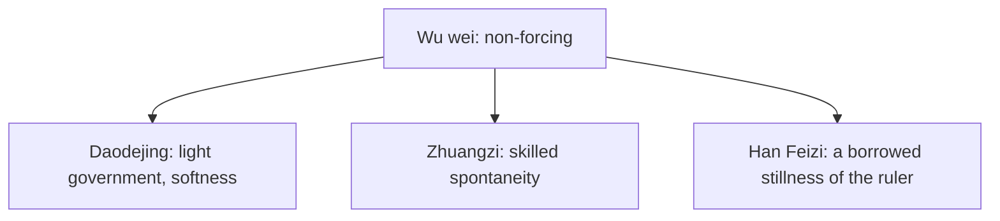

# *Wu wei*

**Prerequisites:** [Dao as way and source](../metaphysics/dao-as-way-and-source.md)

*The teaching Confucius. Portrait by Wu Daozi, 685-758, Tang Dynasty. Credit: Wu Daozi, 685-758, Tang Dynasty.. License: Public domain. Source: [File:Confucius Tang Dynasty.jpg](https://commons.wikimedia.org/wiki/File:Confucius_Tang_Dynasty.jpg).*
*Wu wei* is often translated "non-action," which sounds like passivity. "Non-forcing" or "non-contrivance" is closer. In the [*Daodejing*](../../history/ancient/chinese/texts/daodejing.md) it is a way of ruling and living that does not fight the grain of things: fewer prohibitions, less moral advertising, a potency like water finding a course. In the [*Zhuangzi*](../../history/ancient/chinese/texts/zhuangzi.md) it appears as **skillful spontaneity**: Cook Ding's knife moves through the spaces after long practice, not as laziness and not as a theory imposed on the ox.

[Han Feizi](../../history/ancient/chinese/thinkers/han-feizi.md) can borrow the language of the ruler's stillness and fill it with legal machinery — a reminder that the phrase, like *Dao*, can travel. The first-principles question is always: non-forcing *as opposed to what*, and in the service of what life or what state?

## Working the idea

*Wu wei* is often boxed as "non-action," which makes it sound like inertia or withdrawal. In the *Daodejing* and the *Zhuangzi* it is closer to **not forcing**: action that does not strain against the grain of the *dao*, the way things go when they are not over-managed. Water finds the low place without a plan; a butcher whose knife has not needed sharpening in nineteen years moves through the spaces in the ox. The adept is not lazy. The adept has stopped adding the extra layer of willfulness, display, and anxious control that, on this diagnosis, is what spoils persons and states.

The political edge is sharp. A ruler who cannot stop tinkering, rewarding, and punishing in a restless way generates the very disorder the tinkering was meant to fix. The *Daodejing*'s preference for softness, emptiness, and a small, unambitious community is a critique of conspicuous virtue as well as of aggressive statecraft. Confucians can hear this as a slight against ritual, learning, and the labor of becoming *ren*. A Zhuangzian reply is that the labor itself, when it becomes a project of moral self-importance, is another form of forcing. Legalists will take a different lesson: rely on automatic systems rather than on the ruler's charisma — a "non-action" of a colder kind, in which *fa* and *shi* do the work.

Work the idea by looking for the *contrast class*: what counts as *wei*, the forced or artificial action, in this passage? Sometimes it is war and extravagance; sometimes it is moral striving; sometimes it is a cleverness that will not leave the world alone. Then ask whether *wu wei* is a skill that can be trained (the cook, the swimmer, the cicada-catcher in the *Zhuangzi*) or a letting-go that cannot be pursued as a goal without undoing itself. The paradox is real in the texts; do not resolve it too quickly with a slogan.

## Key ideas

- *Wu wei* is non-forcing, not simple inaction.
- Laozi and Zhuangzi develop it as politics and as skill; Legalism can appropriate the word.
- Always ask what is not being forced, and why.

## Where this leads

- Thinkers: [Laozi](../../history/ancient/chinese/thinkers/laozi.md), [Zhuangzi](../../history/ancient/chinese/thinkers/zhuangzi.md)
- Glossary: [*wu-wei*](../../glossary/chinese/wu-wei.md), [*ziran*](../../glossary/chinese/ziran.md)
