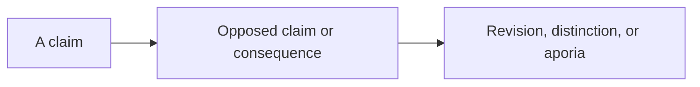

# Contradiction and dialectic

**Prerequisites:** [Being and not-being](../metaphysics/being-and-not-being.md) or [syllogism and the Organon](syllogism-and-the-organon.md)

**Dialectic**, in the Greek tradition, is argument that proceeds by question and answer, or by the testing of opposed claims. [Socrates](../../history/ancient/greek/thinkers/socrates.md)' [elenchus](../epistemology/elenchus-and-aporia.md) is a form of it; [Plato](../../history/ancient/greek/thinkers/plato.md) makes dialectic the highest study in the *Republic* and, in the *Parmenides* and *Sophist*, a training in following hypotheses and distinctions. [Aristotle](../../history/ancient/greek/thinkers/aristotle.md) treats dialectic, in the *Topics*, as reasoning from reputable opinions, and he also states a **principle of non-contradiction** as a first principle that cannot itself be demonstrated in the ordinary way: the same cannot belong and not belong to the same, in the same respect.

The first-principles point is that contradiction is not just a debating foul. It is a pressure on what can be real and what can be said, from [Parmenides](../../history/ancient/greek/thinkers/parmenides.md) onward, and dialectic is the practice of living under that pressure without simply shouting.

## Key ideas

- Dialectic is the practice of testing claims through opposition and distinction.
- Non-contradiction is, for Aristotle, a first principle of being and of speech.
- Socratic, Platonic, and Aristotelian dialectic are related, not identical.

## Where this leads

- [Elenchus and aporia](../epistemology/elenchus-and-aporia.md)
- Texts: [*Sophist*](../../history/ancient/greek/texts/sophist.md), [*Organon*](../../history/ancient/greek/texts/organon.md)
