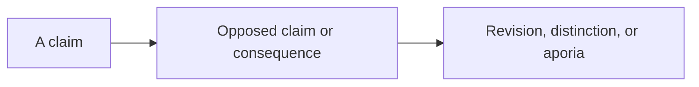

# Contradiction and dialectic

**Prerequisites:** [Being and not-being](../metaphysics/being-and-not-being.md) or [syllogism and the Organon](syllogism-and-the-organon.md)

*Bust of Aristotle. Marble, Roman copy after a Greek bronze original by Lysippos from 330 BC; the alabaster mantle is a modern addition. Credit: After Lysippos. License: Public domain. Source: [File:Aristotle Altemps Inv8575.jpg](https://commons.wikimedia.org/wiki/File:Aristotle_Altemps_Inv8575.jpg).*
**Dialectic**, in the Greek tradition, is argument that proceeds by question and answer, or by the testing of opposed claims. [Socrates](../../history/ancient/greek/thinkers/socrates.md)' [elenchus](../epistemology/elenchus-and-aporia.md) is a form of it; [Plato](../../history/ancient/greek/thinkers/plato.md) makes dialectic the highest study in the *Republic* and, in the *Parmenides* and *Sophist*, a training in following hypotheses and distinctions. [Aristotle](../../history/ancient/greek/thinkers/aristotle.md) treats dialectic, in the *Topics*, as reasoning from reputable opinions, and he also states a **principle of non-contradiction** as a first principle that cannot itself be demonstrated in the ordinary way: the same cannot belong and not belong to the same, in the same respect.

The first-principles point is that contradiction is not just a debating foul. It is a pressure on what can be real and what can be said, from [Parmenides](../../history/ancient/greek/thinkers/parmenides.md) onward, and dialectic is the practice of living under that pressure without simply shouting.

## Working the idea

Greek philosophy learns, early, to treat contradiction as a tool rather than only as a mistake. Parmenides and Zeno already press an opponent by showing that a claim leads to what-is-not, or to endless division. Socratic *elenchus* proceeds by asking, drawing out a consequence, and leaving the interlocutor with two commitments that cannot both be kept. Plato's later dialectic is more ambitious still: a method of collection and division, and, in some dialogues, a route up to unhypothetical first principles. Aristotle, who names the principle of non-contradiction as the firmest principle, also writes the *Topics* and the *Sophistical Refutations* for a world in which people argue, and in which it matters whether a contradiction is real or only apparent (equivocation, scope, a missing qualification).

"Dialectic" therefore does not mean one thing. In some contexts it is a formal pattern of question and answer. In others it is the highest science, or a preparation for it. In Aristotle it can be a reasoned argument from reputable opinions (*endoxa*), useful for philosophy and for civic life, as distinct from demonstration from first principles. Hegelian and later senses of dialectic should not be read back into these pages; they are a later career of the word.

A practical habit: when a text utters a contradiction or stages a clash of views, ask whether the author thinks one side must be dropped, whether a distinction will dissolve the clash, or whether (as sometimes in Heraclitus, or in some readings of Plato's more exploratory dialogues) the tension itself is doing philosophical work. The later Mohist interest in sameness, difference, and the conditions of a reason, and the School of Names' taste for paradox, belong on the same wide map, without being the same method. Logic, here, is not a modern symbolic calculus. It is the craft of seeing when a claim cannot stand with another, and what to do next.

## Key ideas

- Dialectic is the practice of testing claims through opposition and distinction.
- Non-contradiction is, for Aristotle, a first principle of being and of speech.
- Socratic, Platonic, and Aristotelian dialectic are related, not identical.

## Where this leads

- [Elenchus and aporia](../epistemology/elenchus-and-aporia.md)
- Texts: [*Sophist*](../../history/ancient/greek/texts/sophist.md), [*Organon*](../../history/ancient/greek/texts/organon.md)
