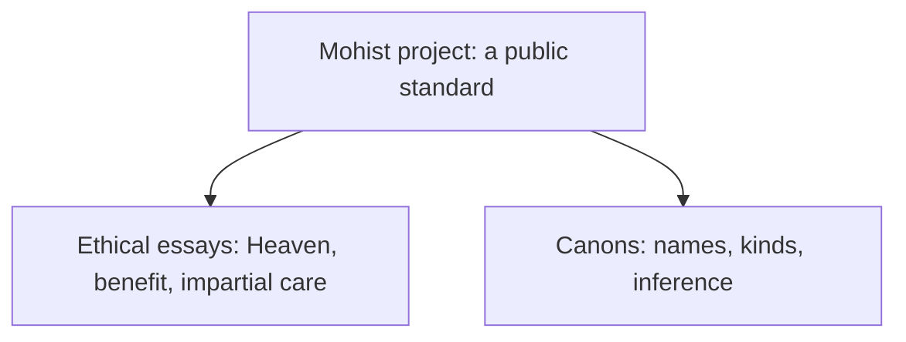

# Later Mohist canons

**Prerequisites:** [Mozi](../../history/ancient/chinese/thinkers/mozi.md) and [names and actuality](../epistemology/names-and-actuality.md)

The later books of the [*Mozi*](../../history/ancient/chinese/texts/mozi.md), often called the Mohist Canons, are terse, damaged, and technically ambitious. They classify names, kinds, sameness and difference, and acceptable ways of inferring and agreeing. They are the main early Chinese attempt to make standards of judgment **public and precise**, in the same broad family of work as [Aristotle](../../history/ancient/greek/thinkers/aristotle.md)'s *Organon*, without being a translation of it.

A first pass should not pretend the canons are easy or fully reconstructed. It should register that they exist, that "the Chinese" were not uninterested in logic, and that they belong next to the [School of Names](paradox-and-the-school-of-names.md) and to [Xunzi](../../history/ancient/chinese/thinkers/xunzi.md)'s theory of names.

## Key ideas

- The later Mohist canons are a technical logic of names and inference.
- They are difficult and fragmentary, and they matter historically.
- They undercut any cartoon of early China as without argumentative standards.

## Where this leads

- [Paradox and the School of Names](paradox-and-the-school-of-names.md)
- Text: [*Mozi*](../../history/ancient/chinese/texts/mozi.md)
