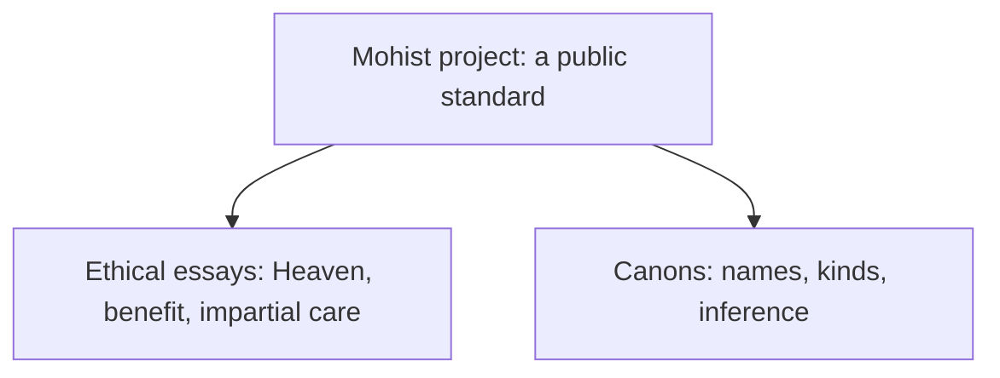

# Later Mohist canons

**Prerequisites:** [Mozi](../../history/ancient/chinese/thinkers/mozi.md) and [names and actuality](../epistemology/names-and-actuality.md)

*The teaching Confucius. Portrait by Wu Daozi, 685-758, Tang Dynasty. Credit: Wu Daozi, 685-758, Tang Dynasty.. License: Public domain. Source: [File:Confucius Tang Dynasty.jpg](https://commons.wikimedia.org/wiki/File:Confucius_Tang_Dynasty.jpg).*
The later books of the [*Mozi*](../../history/ancient/chinese/texts/mozi.md), often called the Mohist Canons, are terse, damaged, and technically ambitious. They classify names, kinds, sameness and difference, and acceptable ways of inferring and agreeing. They are the main early Chinese attempt to make standards of judgment **public and precise**, in the same broad family of work as [Aristotle](../../history/ancient/greek/thinkers/aristotle.md)'s *Organon*, without being a translation of it.

A first pass should not pretend the canons are easy or fully reconstructed. It should register that they exist, that "the Chinese" were not uninterested in logic, and that they belong next to the [School of Names](paradox-and-the-school-of-names.md) and to [Xunzi](../../history/ancient/chinese/thinkers/xunzi.md)'s theory of names.

## Working the idea

The later Mohist *Canons* (*Mozi* 40–45, in the usual numbering) are among the most difficult texts in the classical Chinese corpus: terse, damaged, and written in a technical style that does not behave like the exhortations of early Mohism. They are worth the trouble because they show a Chinese tradition doing something often wrongly reserved, in popular survey courses, to the Greeks: distinguishing kinds of names, probing sameness and difference, and asking how a reason is supposed to support a claim.

A first pass should not try to reconstruct every disputed graph. It should watch a few operations. The Mohists care about how terms are used — whether a name stays with its object, how "this" and "that" shift, how an analogy can carry or fail. They distinguish different kinds of *lei* (kinds, classes) and different ways things can be the same. They are also, still, Mohists: the logical tools serve debates about benefit, care, and making distinctions that practical life requires. This is not logic for its own sake in the Aristotelian sense of a demonstrative science, but it is not mere rhetoric either.

Scholarly work (A. C. Graham's remains a landmark, with later corrections) has shown both how much can be recovered and how much is still uncertain. Be honest about the uncertainty. Do not pretend the *Canons* are a hidden *Organon*, and do not dismiss them as curiosities. When you compare them with the School of Names paradoxes, ask what problem each text thinks it is solving. When you compare them with Aristotle, compare functions (how a reason is offered and tested), not vocabulary. The point of this lesson is to slow the habit of saying that "the Chinese did not do logic," which is a claim about a canon, not a fact about the Mohists.

## Key ideas

- The later Mohist canons are a technical logic of names and inference.
- They are difficult and fragmentary, and they matter historically.
- They undercut any cartoon of early China as without argumentative standards.

## Where this leads

- [Paradox and the School of Names](paradox-and-the-school-of-names.md)
- Text: [*Mozi*](../../history/ancient/chinese/texts/mozi.md)
