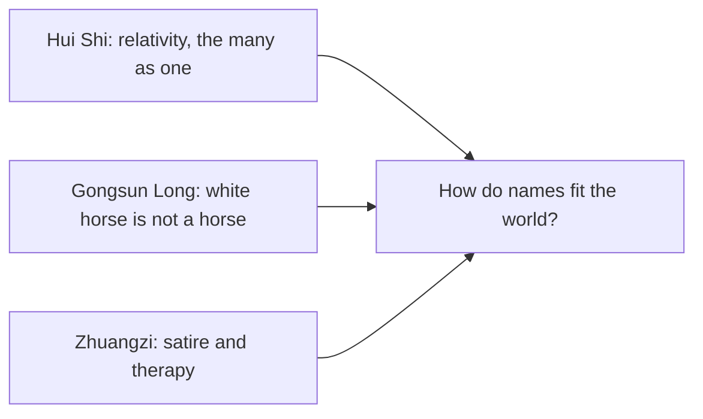

# Paradox and the School of Names

**Prerequisites:** [Gongsun Long and Hui Shi](../../history/ancient/chinese/thinkers/gongsun-long-and-hui-shi.md)

The "School of Names" is a later label for disputers who specialized in the odd edges of language. [Hui Shi](../../history/ancient/chinese/thinkers/gongsun-long-and-hui-shi.md)'s theses press relativity of scale and the thought that the ten thousand things are one. [Gongsun Long](../../history/ancient/chinese/thinkers/gongsun-long-and-hui-shi.md)'s "white horse is not a horse" prizes apart a compound name. [Zhuangzi](../../history/ancient/chinese/thinkers/zhuangzi.md) both plays in this water and mocks the hope of winning the last argument. The later [Mohists](later-mohist-canons.md) try to discipline it.

Paradox, here, is not a toy. It is a way of showing that ordinary speech slides over distinctions — or, in Hui Shi's case, that distinctions themselves may be standpoint-bound. Compare, without identifying, the Greek [Sophists](../../history/ancient/greek/thinkers/protagoras-and-the-sophists.md) and [Zeno](../../history/ancient/greek/thinkers/zeno-of-elea.md): specialists of *logos* at the breaking point, used and abused as "mere sophistry."

## Key ideas

- Hui Shi and Gongsun Long make language and distinction into technical problems.
- Paradox can expose a slide in names, or the limits of disputation.
- Zhuangzi and the Mohists are necessary reading partners.

## Where this leads

- Text: [*Gongsun Longzi*](../../history/ancient/chinese/texts/gongsun-longzi.md)
- [Names and actuality](../epistemology/names-and-actuality.md)
