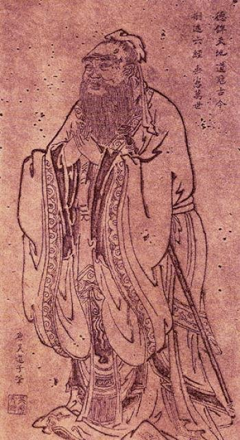
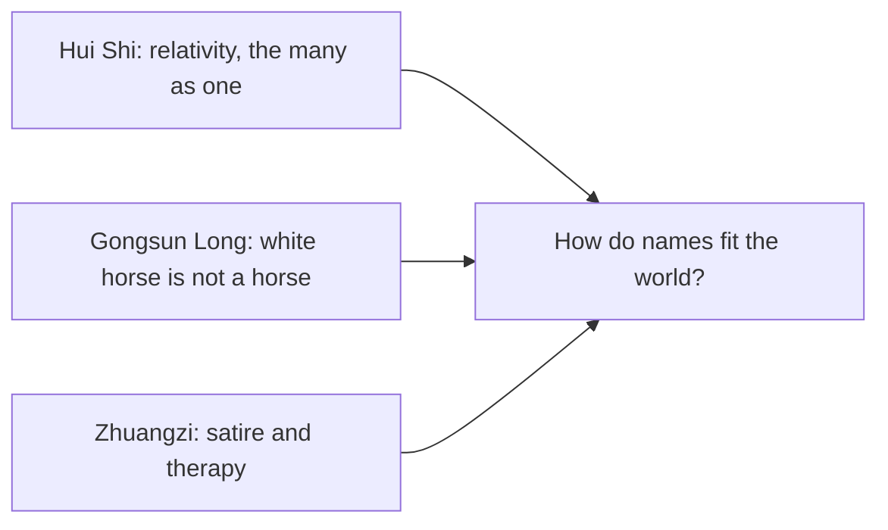

# Paradox and the School of Names

**Prerequisites:** [Gongsun Long and Hui Shi](../../history/ancient/chinese/thinkers/gongsun-long-and-hui-shi.md)

*The teaching Confucius. Portrait by Wu Daozi, 685-758, Tang Dynasty. Credit: Wu Daozi, 685-758, Tang Dynasty.. License: Public domain. Source: [File:Confucius Tang Dynasty.jpg](https://commons.wikimedia.org/wiki/File:Confucius_Tang_Dynasty.jpg).*
The "School of Names" is a later label for disputers who specialized in the odd edges of language. [Hui Shi](../../history/ancient/chinese/thinkers/gongsun-long-and-hui-shi.md)'s theses press relativity of scale and the thought that the ten thousand things are one. [Gongsun Long](../../history/ancient/chinese/thinkers/gongsun-long-and-hui-shi.md)'s "white horse is not a horse" prizes apart a compound name. [Zhuangzi](../../history/ancient/chinese/thinkers/zhuangzi.md) both plays in this water and mocks the hope of winning the last argument. The later [Mohists](later-mohist-canons.md) try to discipline it.

Paradox, here, is not a toy. It is a way of showing that ordinary speech slides over distinctions — or, in Hui Shi's case, that distinctions themselves may be standpoint-bound. Compare, without identifying, the Greek [Sophists](../../history/ancient/greek/thinkers/protagoras-and-the-sophists.md) and [Zeno](../../history/ancient/greek/thinkers/zeno-of-elea.md): specialists of *logos* at the breaking point, used and abused as "mere sophistry."

## Working the idea

The School of Names (*mingjia*) is a later label for a cluster of thinkers — Hui Shi and Gongsun Long are the names that survive with the most texture — who pressed language, sameness, and pointing until ordinary talk broke. "A white horse is not a horse." "The hard and the white are separate." Hui Shi's chain of theses (the boundless, the sameness of similar and different, "I go to Yue today and arrive yesterday") looks, at first, like a game. It is better read as a set of experiments: if you take a distinction, or a spatial or temporal boundary, with full seriousness, does ordinary speech still go through?

Gongsun Long's white-horse puzzle is the best classroom door. One reconstruction: "horse" names a shape, "white horse" names a color-plus-shape; the extensions are not the same, so one may deny that a white horse "is" a horse in the sense of being that looser name's exact counterpart. Other reconstructions lean on reference, on how pointing works, or on a sophistication about mass terms and kinds. You do not need to settle the scholarly dispute to see the point of the exercise: a language that does not watch its names will slide, and a language that watches them too fiercely will offend common sense. The *Zhuangzi* both mocks and uses Hui Shi; the later Mohists try to discipline names in a more constructive key.

A Greek comparison (Zeno's paradoxes, the Megarians, certain stretches of Plato's *Sophist* and *Parmenides*) is fair if it stays at the level of *problem*, not of influence. These texts do not share a school history. They do share a discovery: that speech about one and many, same and other, can be made to say strange things, and that the strangeness may be a clue rather than a joke. Read the remaining fragments slowly, and resist the urge to translate every paradox into a modern logic textbook exercise on the first try.

## Key ideas

- Hui Shi and Gongsun Long make language and distinction into technical problems.
- Paradox can expose a slide in names, or the limits of disputation.
- Zhuangzi and the Mohists are necessary reading partners.

## Where this leads

- Text: [*Gongsun Longzi*](../../history/ancient/chinese/texts/gongsun-longzi.md)
- [Names and actuality](../epistemology/names-and-actuality.md)
