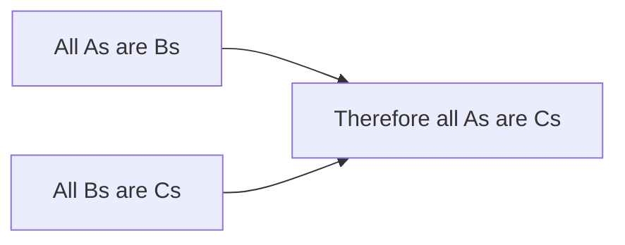

# Syllogism and the *Organon*

**Prerequisites:** [Aristotle](../../history/ancient/greek/thinkers/aristotle.md) and the [*Organon*](../../history/ancient/greek/texts/organon.md)

*Bust of Aristotle. Marble, Roman copy after a Greek bronze original by Lysippos from 330 BC; the alabaster mantle is a modern addition. Credit: After Lysippos. License: Public domain. Source: [File:Aristotle Altemps Inv8575.jpg](https://commons.wikimedia.org/wiki/File:Aristotle_Altemps_Inv8575.jpg).*
[Aristotle](../../history/ancient/greek/thinkers/aristotle.md) is the first to formalize a large body of valid inference in a teachable system. A **syllogism** is a form such as: if all As are Bs and all Bs are Cs, then all As are Cs. The *Prior Analytics* maps which combinations of "all," "some," and "none" actually follow. The *Posterior Analytics* asks what a *demonstration* is — knowledge of causes from first principles. The rest of the *Organon* treats terms, statements, dialectic, and fallacies.

This is term logic, not a modern propositional or predicate calculus (the [Stoics](../../history/ancient/greek/thinkers/zeno-of-citium.md) developed a serious logic of propositions). It is still the beginning of logic as a public standard in the Greek line: "this follows" can be checked, not only felt.

## Working the idea

Aristotle's syllogistic is the first systematic theory of what follows from what in a certain tightly specified form: two premises, a conclusion, terms in subject-predicate position, and figures depending on where the middle term sits. "If A belongs to all B, and B belongs to all C, then A belongs to all C" is not just a useful pattern. In the *Prior Analytics* it is part of a map of which patterns are valid, which are not, and why. The *Organon* as a later corpus (Categories, On Interpretation, the two Analytics, Topics, Sophistical Refutations) places that theory inside a larger craft: how terms and statements work, how demonstration differs from dialectic, how fallacies are produced.

Two corrections keep the lesson honest. First, this is not all of logic, not even all of Aristotle's logic. He has things to say about modality, about induction, about practical reasoning, and about rhetoric's enthymemes. Medieval and modern formal logics will go far beyond the syllogism; they do not make it a museum piece, but they do show its limits (relations, multiple generality, propositional connectives as a system). Second, Aristotle does not invent reasoning. He invents a *theory* of a class of reasonings, and he ties it to a picture of science: demonstration from first principles that are true, prior, and explanatory. The *Posterior Analytics* is where that ambition is clearest, and it is harder than the classroom "Barbara, Celarent" list.

When you use this lesson as a platform, try a small experiment: take a paragraph of argument from Plato or from a public speech and see whether it can be recast as syllogisms without remainder. Often it cannot, and that remainder is interesting. It may be an analogy, a paradigm, a modal slide, or a piece of dialectic from *endoxa*. The *Organon* gives you a sharp tool and a reminder of what the tool was built to cut.

## Key ideas

- A syllogism is a valid pattern of term-reasoning; the *Organon* is its textbook.
- Demonstration is a stricter, scientific use of the same tools.
- Stoic propositional logic is a later, different formal project.

## Where this leads

- Text: [*Organon*](../../history/ancient/greek/texts/organon.md)
- Related: [later Mohist canons](later-mohist-canons.md)
- Glossary: [syllogism](../../glossary/general/syllogism.md)
