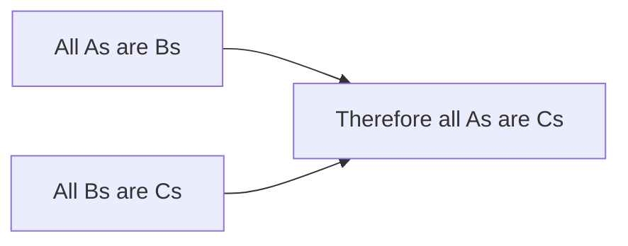

# Syllogism and the *Organon*

**Prerequisites:** [Aristotle](../../history/ancient/greek/thinkers/aristotle.md) and the [*Organon*](../../history/ancient/greek/texts/organon.md)

[Aristotle](../../history/ancient/greek/thinkers/aristotle.md) is the first to formalize a large body of valid inference in a teachable system. A **syllogism** is a form such as: if all As are Bs and all Bs are Cs, then all As are Cs. The *Prior Analytics* maps which combinations of "all," "some," and "none" actually follow. The *Posterior Analytics* asks what a *demonstration* is — knowledge of causes from first principles. The rest of the *Organon* treats terms, statements, dialectic, and fallacies.

This is term logic, not a modern propositional or predicate calculus (the [Stoics](../../history/ancient/greek/thinkers/zeno-of-citium.md) developed a serious logic of propositions). It is still the beginning of logic as a public standard in the Greek line: "this follows" can be checked, not only felt.

## Key ideas

- A syllogism is a valid pattern of term-reasoning; the *Organon* is its textbook.
- Demonstration is a stricter, scientific use of the same tools.
- Stoic propositional logic is a later, different formal project.

## Where this leads

- Text: [*Organon*](../../history/ancient/greek/texts/organon.md)
- Related: [later Mohist canons](later-mohist-canons.md)
- Glossary: [syllogism](../../glossary/general/syllogism.md)
