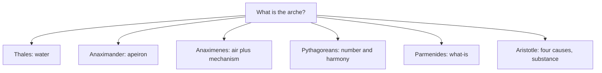

# *Arche* and first principles

**Prerequisites:** [What philosophy is](../../README.md) and [Greek foundational concepts](../../history/ancient/greek/01-foundational-concepts.md)

*Bust of Aristotle. Marble, Roman copy after a Greek bronze original by Lysippos from 330 BC; the alabaster mantle is a modern addition. Credit: After Lysippos. License: Public domain. Source: [File:Aristotle Altemps Inv8575.jpg](https://commons.wikimedia.org/wiki/File:Aristotle_Altemps_Inv8575.jpg).*
An *arche* is a beginning, a source, or a ruling principle. In early Greek philosophy it names whatever you take to be fundamental: the stuff or structure from which the ordered world arises, and to which change can be referred. To look for an *arche* is already a philosophical move. It says that the world's variety might be intelligible if we can find the right starting point.

[Thales](../../history/ancient/greek/thinkers/thales.md) is remembered for water; [Anaximander](../../history/ancient/greek/thinkers/anaximander.md) for the indefinite *apeiron*; [Anaximenes](../../history/ancient/greek/thinkers/anaximenes.md) for air with rarefaction and condensation. [Pythagoras](../../history/ancient/greek/thinkers/pythagoras.md) shifts the bet toward number and ratio. [Parmenides](../../history/ancient/greek/thinkers/parmenides.md) makes "what-is" itself the only possible starting point. Later metaphysics never drops the question; it just gives it more names: [substance](substance.md), [form](form-and-matter.md), the [unmoved mover](../../history/ancient/greek/texts/metaphysics.md), the [One](the-one-and-emanation.md).

A first principle is not only a historical curiosity about water or air. It is a demand for the right kind of explanation: not an endless list, and not a mythic "a god did it" that cannot be examined. [Aristotle](../../history/ancient/greek/thinkers/aristotle.md) will distinguish material starting-points from formal and final ones, and will treat first philosophy as knowledge of first causes. In the Chinese path, a close cousin is the question of the [*Dao*](dao-as-way-and-source.md): not always "what stuff?" but "what way or source do the ten thousand things follow?"

## Working the idea

An *archē* is a starting-point and a ruling principle, not merely "the first thing that happened." When the early Greek inquirers look for the *archē* of things — water, the boundless, air, fire, the four roots, atoms — they are looking for that from which things are, that which governs their changes, and that which would make a *logos* of nature possible. Aristotle later turns this search into a discipline. First philosophy asks about the first principles and causes of what is, and about a principle that could be prior even to the principles of a special science.

The word therefore travels. In a Presocratic setting it can name a material source. In Plato it can name forms, or the unhypothetical first principle of the *Republic*'s divided line, or, in a later reading, the One. In Aristotle it can name the axioms of a science, the four causes, or the unmoved mover as a principle of motion. Confusion begins when a later writer says "first principles" and a reader hears only "basic facts I will not prove." For these authors a principle is often *explanatory*. It should make the rest intelligible, not just sit at the front of a list.

A good reading habit is to ask, of each claim to an *archē*: is this a constituent (what things are made of), a beginning in time, a ruling law, a highest good, or a logical starting-point? Many early fragments mix these. Aristotle's criticism of his predecessors is, in part, a criticism of that mixing: they told him the matter and forgot the form, or the mover, or the end. You do not have to accept his fourfold scheme to find the question useful. Chinese inquiries into the *dao*, or into *qi* and the phases, are not the same search under another name, but they can be placed nearby as another way of asking what, if anything, the ten thousand things depend on.

## Key ideas

- An *arche* is a source or ruling principle that is supposed to make the many intelligible.
- The early answers differ; the form of the question is what they share.
- Later Greek and Chinese thought rename the question without dropping it.

## Where this leads

- [The problem of change](the-problem-of-change.md), [logos as account and order](logos-as-account-and-order.md)
- Thinkers: [Thales](../../history/ancient/greek/thinkers/thales.md), [Anaximander](../../history/ancient/greek/thinkers/anaximander.md)
- Glossary: [*arche*](../../glossary/greek/arche.md)
