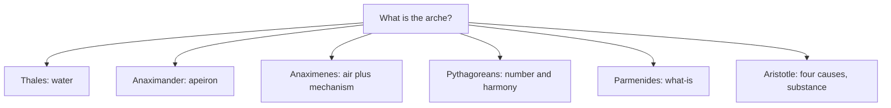

# *Arche* and first principles

**Prerequisites:** [What philosophy is](../../README.md) and [Greek foundational concepts](../../history/ancient/greek/01-foundational-concepts.md)

An *arche* is a beginning, a source, or a ruling principle. In early Greek philosophy it names whatever you take to be fundamental: the stuff or structure from which the ordered world arises, and to which change can be referred. To look for an *arche* is already a philosophical move. It says that the world's variety might be intelligible if we can find the right starting point.

[Thales](../../history/ancient/greek/thinkers/thales.md) is remembered for water; [Anaximander](../../history/ancient/greek/thinkers/anaximander.md) for the indefinite *apeiron*; [Anaximenes](../../history/ancient/greek/thinkers/anaximenes.md) for air with rarefaction and condensation. [Pythagoras](../../history/ancient/greek/thinkers/pythagoras.md) shifts the bet toward number and ratio. [Parmenides](../../history/ancient/greek/thinkers/parmenides.md) makes "what-is" itself the only possible starting point. Later metaphysics never drops the question; it just gives it more names: [substance](substance.md), [form](form-and-matter.md), the [unmoved mover](../../history/ancient/greek/texts/metaphysics.md), the [One](the-one-and-emanation.md).

A first principle is not only a historical curiosity about water or air. It is a demand for the right kind of explanation: not an endless list, and not a mythic "a god did it" that cannot be examined. [Aristotle](../../history/ancient/greek/thinkers/aristotle.md) will distinguish material starting-points from formal and final ones, and will treat first philosophy as knowledge of first causes. In the Chinese path, a close cousin is the question of the [*Dao*](dao-as-way-and-source.md): not always "what stuff?" but "what way or source do the ten thousand things follow?"

## Key ideas

- An *arche* is a source or ruling principle that is supposed to make the many intelligible.
- The early answers differ; the form of the question is what they share.
- Later Greek and Chinese thought rename the question without dropping it.

## Where this leads

- [The problem of change](the-problem-of-change.md), [logos as account and order](logos-as-account-and-order.md)
- Thinkers: [Thales](../../history/ancient/greek/thinkers/thales.md), [Anaximander](../../history/ancient/greek/thinkers/anaximander.md)
- Glossary: [*arche*](../../glossary/greek/arche.md)
