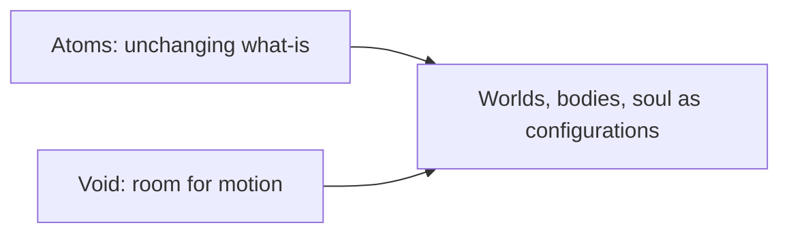

# Atoms and void

**Prerequisites:** [Being and not-being](being-and-not-being.md) and [Democritus and Leucippus](../../history/ancient/greek/thinkers/democritus-and-leucippus.md)

Atomism is a reply to [Parmenides](../../history/ancient/greek/thinkers/parmenides.md) and [Zeno](../../history/ancient/greek/thinkers/zeno-of-elea.md). **Atoms** are uncuttable, eternal beings (what-is). The **void** is empty space (a controlled "what-is-not") that makes motion and plurality possible. Macroscopic change is rearrangement, not generation from nothing. Sensible qualities are effects on us; atoms have shape, size, and motion. The soul, too, is atomic, which later lets [Epicurus](../../history/ancient/greek/thinkers/epicurus.md) say that death is dispersal.

[Aristotle](../../history/ancient/greek/thinkers/aristotle.md) rejected a void and actual indivisibles, and thought form and purpose were left unexplained. The early modern revival of corpuscles is a distant afterlife, not the same theory. For this path, the first-principles achievement is already ancient: stable being plus a world in motion, at a clear metaphysical price.

## Key ideas

- Unchanging atoms plus void allow motion without generation from nothing.
- Qualities and soul are explained as arrangements and effects.
- Epicurean ethics later uses this physics to remove the fear of death.

## Where this leads

- [Epicurus](../../history/ancient/greek/thinkers/epicurus.md)
- Contrast: [form and matter](form-and-matter.md)
