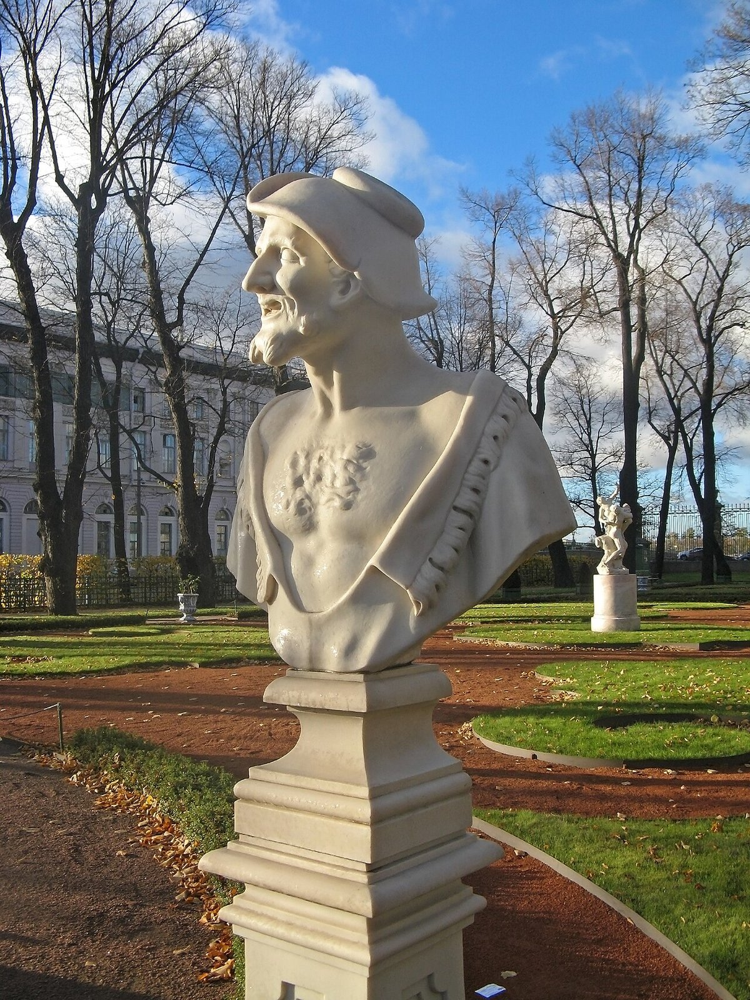
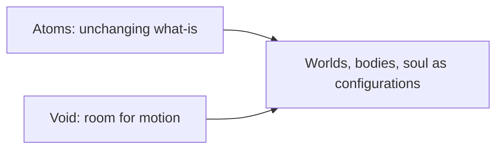

# Atoms and void

**Prerequisites:** [Being and not-being](being-and-not-being.md) and [Democritus and Leucippus](../../history/ancient/greek/thinkers/democritus-and-leucippus.md)

*Bust of Democritus, Summer Garden, Saint Petersburg, Russia Credit: Екатерина Борисова. License: [CC BY-SA 4.0](https://creativecommons.org/licenses/by-sa/4.0). Source: [File:Летний сад. Демокрит2.jpg](https://commons.wikimedia.org/wiki/File:Летний_сад._Демокрит2.jpg).*
Atomism is a reply to [Parmenides](../../history/ancient/greek/thinkers/parmenides.md) and [Zeno](../../history/ancient/greek/thinkers/zeno-of-elea.md). **Atoms** are uncuttable, eternal beings (what-is). The **void** is empty space (a controlled "what-is-not") that makes motion and plurality possible. Macroscopic change is rearrangement, not generation from nothing. Sensible qualities are effects on us; atoms have shape, size, and motion. The soul, too, is atomic, which later lets [Epicurus](../../history/ancient/greek/thinkers/epicurus.md) say that death is dispersal.

[Aristotle](../../history/ancient/greek/thinkers/aristotle.md) rejected a void and actual indivisibles, and thought form and purpose were left unexplained. The early modern revival of corpuscles is a distant afterlife, not the same theory. For this path, the first-principles achievement is already ancient: stable being plus a world in motion, at a clear metaphysical price.

## Working the idea

Atomism is a proposed solution to a problem, not a first naive picture of dust. After Parmenides, it had become hard to say that things come to be and perish, or that there is real motion, without speaking of what-is coming from what-is-not. Leucippus and Democritus keep an Eleatic severity about **what is**: the atom is full, uncuttable, eternal, and unchanging in its substance. What they add is **what is not**, understood as void — real emptiness in which atoms can move, combine, and separate. Macroscopic coming-to-be is rearrangement, not generation from nothing. The bitterness of a taste, the color of a surface, the feel of a thing, can then be traced (in a way that later philosophers will debate) to shapes, arrangements, and impacts.

Epicurus inherits the bare ontology and turns it toward ethics. If everything that happens is atoms and void, then the gods, if they exist, need not be feared as managers of thunder and fate, and death is the dispersion of a compound, not a journey of the surviving person into punishment. The swerve (*parenklisis*), in the Epicurean development, is a notorious extra: a tiny deviation meant to block strict necessity and to make room for the sort of agency a human life requires. Ancient critics found it ad hoc; modern readers still argue about what work it is supposed to do.

Two cautions help. First, ancient atoms are not nineteenth-century chemical atoms and not quantum particles. The later science can illuminate why the *question* was good; it should not be read back as if Democritus had already guessed the periodic table. Second, atomism was one competitor among others (four elements, seeds, Aristotelian continua). Read it as a research program with ethical stakes, then ask why Plato and Aristotle rejected it so firmly, and why it survived anyway in the garden of Epicurus and, much later, in a transformed early modern physics.

## Key ideas

- Unchanging atoms plus void allow motion without generation from nothing.
- Qualities and soul are explained as arrangements and effects.
- Epicurean ethics later uses this physics to remove the fear of death.

## Where this leads

- [Epicurus](../../history/ancient/greek/thinkers/epicurus.md)
- Contrast: [form and matter](form-and-matter.md)
