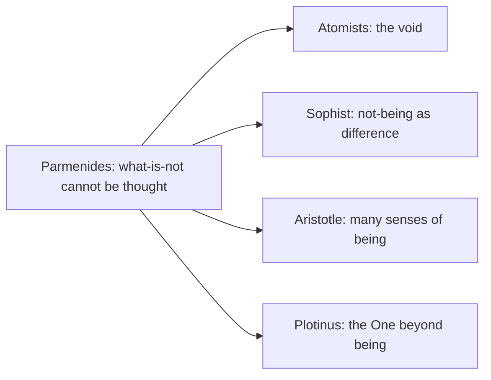

# Being and not-being

**Prerequisites:** [The problem of change](the-problem-of-change.md) and [Parmenides](../../history/ancient/greek/thinkers/parmenides.md)

[Parmenides](../../history/ancient/greek/thinkers/parmenides.md) makes "it is" the only walkable path, and "it is not" a path that cannot be thought or said. From this he draws a one, ungenerated, unchanging being. The cost is obvious: ordinary speech is full of not-being — absence, difference, falsehood, change. If those cannot be said, philosophy cannot even state the appearances it wants to save.

Later Greek thought spends a remarkable amount of energy buying not-being back at a controlled price. The [atomists](atoms-and-void.md) admit a void, a "what-is-not" that is real enough for motion. [Plato](../../history/ancient/greek/thinkers/plato.md)'s [*Sophist*](../../history/ancient/greek/texts/sophist.md) reinterprets not-being as **difference**: a way one kind is *not* another, which makes false statement possible without talking about sheer nothing. [Aristotle](../../history/ancient/greek/thinkers/aristotle.md) distinguishes senses of being (the categories, being as truth, being as potential and actual) so that "is not" does not always mean the same thing. [Plotinus](../../history/ancient/greek/thinkers/plotinus.md) will even put the One *beyond* being, which is another way of saying that the first principle is not just one more entity in the inventory.

The lesson is methodological as well as metaphysical. Before you deny change or plurality, ask what "is" and "is not" are doing in the sentence. Many apparent contradictions are collisions of senses.

## Key ideas

- Parmenides closes the path of "is not"; later philosophy reopens it carefully.
- Void, difference, and the many senses of being are three classic reopenings.
- Watching what "is" means is part of the work, not a preamble to it.

## Where this leads

- [Atoms and void](atoms-and-void.md), [the Forms](the-forms.md), [substance](substance.md)
- Text: [*Sophist*](../../history/ancient/greek/texts/sophist.md)
