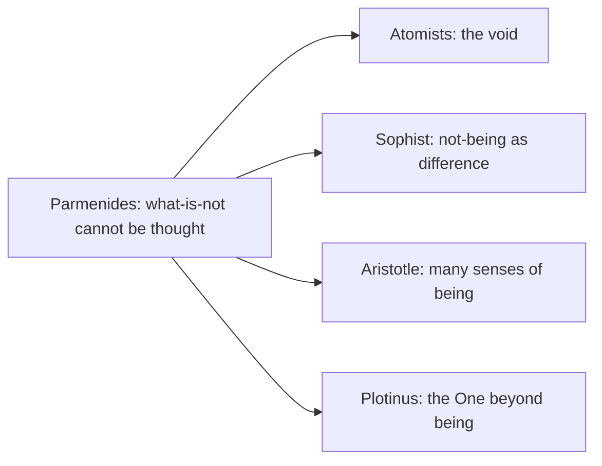

# Being and not-being

**Prerequisites:** [The problem of change](the-problem-of-change.md) and [Parmenides](../../history/ancient/greek/thinkers/parmenides.md)

*Bust of Aristotle. Marble, Roman copy after a Greek bronze original by Lysippos from 330 BC; the alabaster mantle is a modern addition. Credit: After Lysippos. License: Public domain. Source: [File:Aristotle Altemps Inv8575.jpg](https://commons.wikimedia.org/wiki/File:Aristotle_Altemps_Inv8575.jpg).*
[Parmenides](../../history/ancient/greek/thinkers/parmenides.md) makes "it is" the only walkable path, and "it is not" a path that cannot be thought or said. From this he draws a one, ungenerated, unchanging being. The cost is obvious: ordinary speech is full of not-being — absence, difference, falsehood, change. If those cannot be said, philosophy cannot even state the appearances it wants to save.

Later Greek thought spends a remarkable amount of energy buying not-being back at a controlled price. The [atomists](atoms-and-void.md) admit a void, a "what-is-not" that is real enough for motion. [Plato](../../history/ancient/greek/thinkers/plato.md)'s [*Sophist*](../../history/ancient/greek/texts/sophist.md) reinterprets not-being as **difference**: a way one kind is *not* another, which makes false statement possible without talking about sheer nothing. [Aristotle](../../history/ancient/greek/thinkers/aristotle.md) distinguishes senses of being (the categories, being as truth, being as potential and actual) so that "is not" does not always mean the same thing. [Plotinus](../../history/ancient/greek/thinkers/plotinus.md) will even put the One *beyond* being, which is another way of saying that the first principle is not just one more entity in the inventory.

The lesson is methodological as well as metaphysical. Before you deny change or plurality, ask what "is" and "is not" are doing in the sentence. Many apparent contradictions are collisions of senses.

## Working the idea

Parmenides' poem makes "is" and "is not" into the hardest words in Greek philosophy. The goddess tells the young man that the path of "is not" cannot be followed: you cannot know or point out what is not. What remains is what-is — ungenerated, imperishable, whole, unmoving, and complete. The shock of this, for later thinkers, is that ordinary speech about coming-to-be, change, diversity, and empty space seems to traffic in not-being. How, then, can there be a world of many changing things?

The later tradition is, in large part, a set of answers to that shock. Atomists admit void as a sanctioned "what is not." Plato, in the *Sophist*, distinguishes kinds of not-being (not the sheer nothing, but the *other* than) so that false speech and difference can be saved. Aristotle distinguishes the ways "being" is said, and treats potentiality as a middle route between sheer being and sheer not-being. These are not three styles of the same slogan. They are three ways of keeping a world while paying Parmenides a debt.

When you read a metaphysical text in this tradition, find the author's *permission* for talking about what is not, or about what is not yet. If there is no such permission, the text may be closer to Parmenides than its surface variety suggests. If the permission is cheap ("of course things change"), the Eleatic challenge has not yet been heard. The lesson's job is to make that challenge audible, so that later technical terms — form, void, dunamis, the different — can be seen as answers rather than as vocabulary for its own sake.

## Key ideas

- Parmenides closes the path of "is not"; later philosophy reopens it carefully.
- Void, difference, and the many senses of being are three classic reopenings.
- Watching what "is" means is part of the work, not a preamble to it.

## Where this leads

- [Atoms and void](atoms-and-void.md), [the Forms](the-forms.md), [substance](substance.md)
- Text: [*Sophist*](../../history/ancient/greek/texts/sophist.md)
