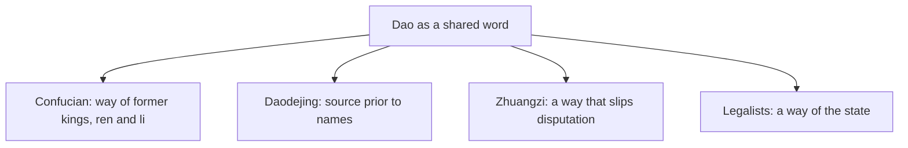

# *Dao* as way and source

**Prerequisites:** [Chinese foundational concepts](../../history/ancient/chinese/01-foundational-concepts.md)

*Dao* means a road or path, and by extension a way of doing something, a teaching, or the way the world itself operates. Every early Chinese school claims a *dao*. Confucians speak of the way of the former kings and of ritual humaneness. Legalists offer a way of the state. The [*Daodejing*](../../history/ancient/chinese/texts/daodejing.md) uses the word more radically: the *Dao* that can be told is not the constant *Dao*; a source or process prior to named things is that from which the ten thousand things arise.

So *Dao* is not automatically "Daoism." It is the general word for the right path and, in some texts, for the deep structure of reality. Comparison with [*logos*](logos-as-account-and-order.md) can help and can mislead: both can mean an intelligible order, but the *Daodejing* often treats the deepest Way as what exceeds a finished account. [Zhuangzi](../../history/ancient/chinese/thinkers/zhuangzi.md) then loosens even the urge to pin the Way down as a thesis.

## Key ideas

- *Dao* is a shared word, not the private property of Daoism.
- In the *Daodejing* it names a source prior to names, as well as a way of acting.
- Compare *logos* carefully; do not treat the two as one term in two languages.

## Where this leads

- [Wu wei](../ethics/wu-wei.md)
- Texts: [*Daodejing*](../../history/ancient/chinese/texts/daodejing.md)
- Glossary: [*dao*](../../glossary/chinese/dao.md)
