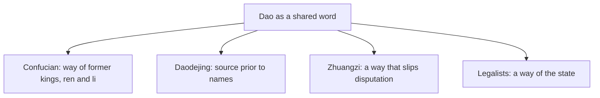

# *Dao* as way and source

**Prerequisites:** [Chinese foundational concepts](../../history/ancient/chinese/01-foundational-concepts.md)

*The teaching Confucius. Portrait by Wu Daozi, 685-758, Tang Dynasty. Credit: Wu Daozi, 685-758, Tang Dynasty.. License: Public domain. Source: [File:Confucius Tang Dynasty.jpg](https://commons.wikimedia.org/wiki/File:Confucius_Tang_Dynasty.jpg).*
*Dao* means a road or path, and by extension a way of doing something, a teaching, or the way the world itself operates. Every early Chinese school claims a *dao*. Confucians speak of the way of the former kings and of ritual humaneness. Legalists offer a way of the state. The [*Daodejing*](../../history/ancient/chinese/texts/daodejing.md) uses the word more radically: the *Dao* that can be told is not the constant *Dao*; a source or process prior to named things is that from which the ten thousand things arise.

So *Dao* is not automatically "Daoism." It is the general word for the right path and, in some texts, for the deep structure of reality. Comparison with [*logos*](logos-as-account-and-order.md) can help and can mislead: both can mean an intelligible order, but the *Daodejing* often treats the deepest Way as what exceeds a finished account. [Zhuangzi](../../history/ancient/chinese/thinkers/zhuangzi.md) then loosens even the urge to pin the Way down as a thesis.

## Working the idea

*Dao* is a word with an ordinary life — a road, a way of doing something, a teaching one can walk — and a philosophical life in which it names the source and pattern of the ten thousand things, especially in the *Daodejing*. The two lives should be kept in contact. A *dao* you can walk (Confucius' way of becoming human through ritual and rightness) is already more than a footpath; it is a practice with a direction. The *Daodejing* radicalizes the word: the *dao* that can be spoken is not the constant *dao*; the nameless is the beginning of Heaven and Earth. Here *dao* is not a doctrine on a scroll. It is that by which things are so, before names cut them up.

This makes translation permanently awkward. "Way" keeps the ordinary sense and underplays the cosmic one. "The Dao" as a proper name in English can sound like a deity or a substance sitting behind the world. The text itself prefers water, the uncarved block, the empty hub, the female, the valley: images of a source that does not display itself as a ruler among other rulers. Later religious Daoism will personify, ritualize, and expand this language. The classical philosophical texts are more elusive, and they should be allowed to stay elusive until a reading is earned.

A working question: is *dao* in this passage something one *follows* (a path of life), something one *attunes to* (a pattern already in things), or something that *gives rise* to things (a source)? Many chapters mix these. Comparison with a Greek *archē* or with *logos* can be suggestive if you do not force a match. The Greek terms grow out of a quarrel about being and explanation; *dao* grows out of a quarrel about naming, ruling, and forcing. Read the images first, then the politics of *wu wei*, then ask what kind of source would make that politics look like wisdom rather than quietism.

## Key ideas

- *Dao* is a shared word, not the private property of Daoism.
- In the *Daodejing* it names a source prior to names, as well as a way of acting.
- Compare *logos* carefully; do not treat the two as one term in two languages.

## Where this leads

- [Wu wei](../ethics/wu-wei.md)
- Texts: [*Daodejing*](../../history/ancient/chinese/texts/daodejing.md)
- Glossary: [*dao*](../../glossary/chinese/dao.md)
