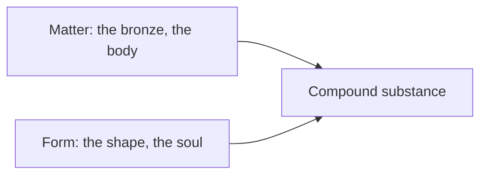

# Form and matter

**Prerequisites:** [The Forms](the-forms.md) and [Aristotle](../../history/ancient/greek/thinkers/aristotle.md)

[Aristotle](../../history/ancient/greek/thinkers/aristotle.md) agrees that knowledge needs stable objects and rejects Plato's *separate* Forms. Form and matter become principles *of* this-worldly [substances](substance.md). A bronze statue's form is its shape (and, more deeply, what it is); its matter is the bronze. A living thing's form is its soul, the organization that makes this body a living body; its matter is the organic body. This is [hylomorphism](../../glossary/greek/hylomorphism.md).

Matter is not "stuff in general" in a modern sense; it is always matter *for* some form, and at the limit Aristotle speaks of a prime matter that is never found bare. Form is not a ghostly duplicate in another world; it is the actuality of the thing. Change can then be understood as a matter taking on or losing form, which is also the language of [potentiality and actuality](potentiality-and-actuality.md).

## Key ideas

- Form and matter compose substances; they are not a second world of Forms.
- Matter is relative to form; form is the actuality of the compound.
- This is Aristotle's main alternative to Platonic separation.

## Where this leads

- [Substance](substance.md), [potentiality and actuality](potentiality-and-actuality.md), [the four causes](the-four-causes.md)
- Text: [*Metaphysics*](../../history/ancient/greek/texts/metaphysics.md), [*On the Soul*](../../history/ancient/greek/texts/de-anima.md)
