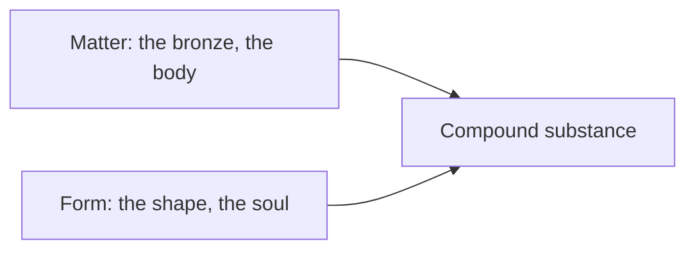

# Form and matter

**Prerequisites:** [The Forms](the-forms.md) and [Aristotle](../../history/ancient/greek/thinkers/aristotle.md)

*Bust of Aristotle. Marble, Roman copy after a Greek bronze original by Lysippos from 330 BC; the alabaster mantle is a modern addition. Credit: After Lysippos. License: Public domain. Source: [File:Aristotle Altemps Inv8575.jpg](https://commons.wikimedia.org/wiki/File:Aristotle_Altemps_Inv8575.jpg).*
[Aristotle](../../history/ancient/greek/thinkers/aristotle.md) agrees that knowledge needs stable objects and rejects Plato's *separate* Forms. Form and matter become principles *of* this-worldly [substances](substance.md). A bronze statue's form is its shape (and, more deeply, what it is); its matter is the bronze. A living thing's form is its soul, the organization that makes this body a living body; its matter is the organic body. This is [hylomorphism](../../glossary/greek/hylomorphism.md).

Matter is not "stuff in general" in a modern sense; it is always matter *for* some form, and at the limit Aristotle speaks of a prime matter that is never found bare. Form is not a ghostly duplicate in another world; it is the actuality of the thing. Change can then be understood as a matter taking on or losing form, which is also the language of [potentiality and actuality](potentiality-and-actuality.md).

## Working the idea

Aristotle's form-matter (*eidos* / *hyle*) analysis is an answer to a cluster of problems: what makes this bronze sphere *this* sphere, what remains through change, and how a thing can be one rather than a heap. Matter is that which is potentially the thing; form is the organization and "what-it-is-to-be" that makes the potential actual. The bronze can be a statue, a bowl, or a lump; the statue-form is what the bronze, in this case, has become. The analysis is hierarchical and repeatable: bronze itself can be treated as matter relative to the statue, and as a formed material relative to its elements. There is no one ultimate "stuff" in the sense the early material monists wanted, at least not as the whole story of a substance.

This is not Plato's form with a new label. Platonic forms, on the usual reading, stand apart as independently real paradigms. Aristotelian forms are the forms *of* this-worldly substances (with notorious complications for mathematicals and for the unmoved mover). Aristotle thinks he can have the intelligibility Plato wanted — you can define, explain, and know — without a separate realm. Whether he succeeds, and whether the form is particular or general, are old scholarly fights. You can learn the tool before you join the fight: try analyzing an artifact, a living body, and a heap of sand, and notice where the tool feels natural and where it slips.

The tool also structures change and explanation. Coming-to-be is the arrival of a form in a matter that can take it; destruction is its loss. The four causes will assign the formal cause a job alongside matter, mover, and end. Later hylomorphism in medieval and contemporary philosophy is a descendant, not a repeat. When a later writer says "form and matter," check whether the words still do Aristotelian work or have become a loose metaphor for "shape plus stuff."

## Key ideas

- Form and matter compose substances; they are not a second world of Forms.
- Matter is relative to form; form is the actuality of the compound.
- This is Aristotle's main alternative to Platonic separation.

## Where this leads

- [Substance](substance.md), [potentiality and actuality](potentiality-and-actuality.md), [the four causes](the-four-causes.md)
- Text: [*Metaphysics*](../../history/ancient/greek/texts/metaphysics.md), [*On the Soul*](../../history/ancient/greek/texts/de-anima.md)
