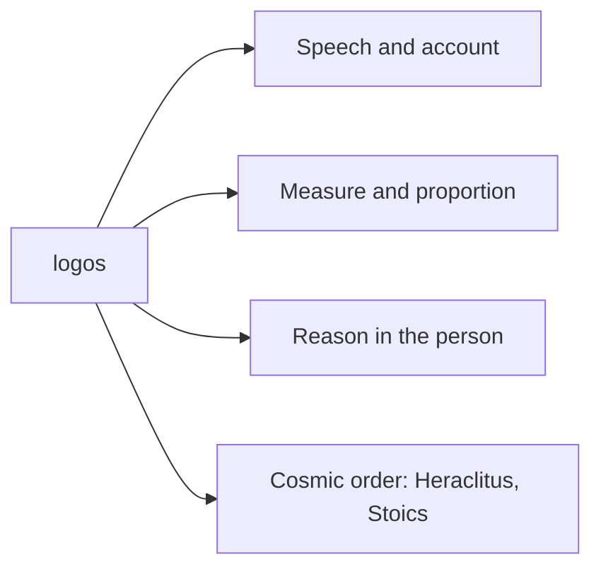

# *Logos* as account and order

**Prerequisites:** [*Arche* and first principles](arche-and-first-principles.md)

*Bust of Aristotle. Marble, Roman copy after a Greek bronze original by Lysippos from 330 BC; the alabaster mantle is a modern addition. Credit: After Lysippos. License: Public domain. Source: [File:Aristotle Altemps Inv8575.jpg](https://commons.wikimedia.org/wiki/File:Aristotle_Altemps_Inv8575.jpg).*
*Logos* is one of the most overloaded words in Greek. It can mean word, speech, story, proportion, reason, or an explanatory account. In philosophy it often means the kind of account you can give *and defend*. To "give a *logos*" of something is to say what it is, and why.

[Heraclitus](../../history/ancient/greek/thinkers/heraclitus.md) uses the word in a stronger sense: there is a common structure or measure to things, even though people live as if they had a private understanding. The world is not a heap of episodes. It is ordered, and that order can, in principle, be spoken — though speaking it well is hard. [Aristotle](../../history/ancient/greek/thinkers/aristotle.md)'s logic is a discipline for inspecting accounts. The [Stoics](../../history/ancient/greek/thinkers/zeno-of-citium.md) will identify a cosmic *logos* with a rational fire or with Zeus, so that ethics becomes "living according to" that order. When the Gospel of John opens with "In the beginning was the *Logos*," it is using a word already thick with this history (see [the four Gospels](../../../religion/abrahamic/christianity/bible/new-testament/02-the-four-gospels.md)). You do not need to collapse John into Heraclitus. You do need to hear that the word was not empty.

A useful comparison, held lightly, is with [*Dao*](dao-as-way-and-source.md): both can name the intelligible or followable structure of things. The *Daodejing* often treats the deepest Way as what slips the net of names; a Greek *logos* is more often something you are trying to state. The contrast is real, and so is the shared sense that the world is not mere noise.

## Working the idea

*Logos* is one of the most overworked words in the Greek tradition, and the only safe way to use it is to let each author narrow it. At the base it is speech, account, reason, and proportion: that by which something can be said and, often, that by which a thing or a cosmos is ordered so as to be sayable. Heraclitus' *logos* is already more than a lecture. It is a common order people fail to notice, even as they live by it, like sleepers missing the shared world. In Plato, *logos* can be a definition, a reasoned account as opposed to a mere true opinion, or the soul's silent conversation with itself. In Aristotle it is, among other things, the rational power that makes a political animal, and the account that states a thing's what-it-is. The Stoics give *logos* a cosmic career: the rational fire, the organizing principle of nature, with human reason as a share in it.

The Johannine "In the beginning was the *Logos*" is a later, theological use, already in conversation with Greek philosophical language and with Jewish traditions of God's Word and Wisdom. It should not be treated as a simple borrowing of Heraclitus, or as irrelevant to him. It is a reminder that the word's history is longer than any one school.

A working discipline: whenever a translation says "reason," "word," "account," or "ratio," check whether the Greek is *logos* and what job it is doing in that sentence. Is someone giving a *logos* (an explanation)? Is the world said to *have* a *logos* (an order)? Is a person being asked to live according to *logos* (reason as a standard)? These are related, but they are not identical claims. Once you can hear the differences, the later habit of talking about "logocentrism" or "the Greek rationalism" looks coarser than the texts.

## Key ideas

- *Logos* ranges from a defendable account to the world's common measure.
- Heraclitus, Aristotle's logic, and Stoic physics use the word at different depths.
- Comparison with *Dao* is suggestive and not an identity.

## Where this leads

- [The problem of change](the-problem-of-change.md)
- [Living according to nature](../ethics/living-according-to-nature.md)
- Glossary: [*logos*](../../glossary/greek/logos.md)
