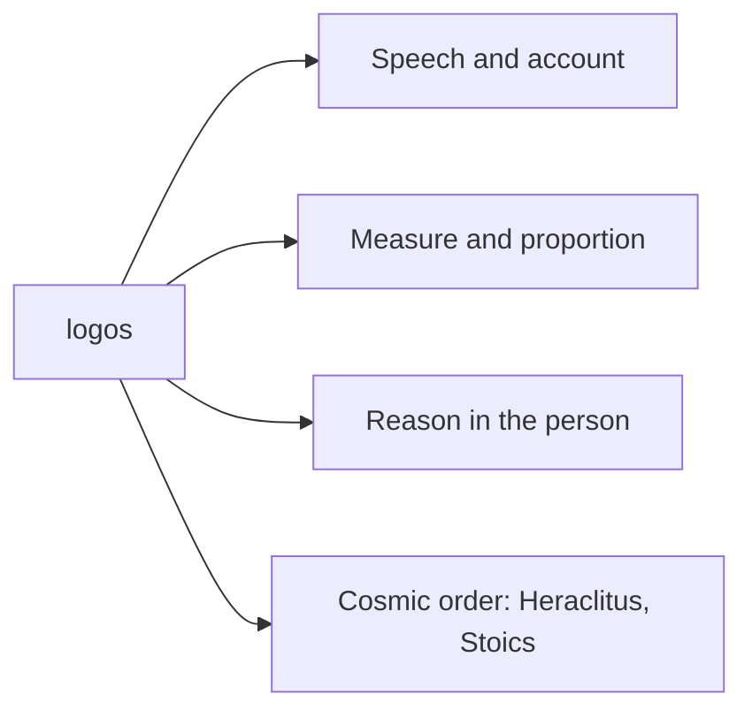

# *Logos* as account and order

**Prerequisites:** [*Arche* and first principles](arche-and-first-principles.md)

*Logos* is one of the most overloaded words in Greek. It can mean word, speech, story, proportion, reason, or an explanatory account. In philosophy it often means the kind of account you can give *and defend*. To "give a *logos*" of something is to say what it is, and why.

[Heraclitus](../../history/ancient/greek/thinkers/heraclitus.md) uses the word in a stronger sense: there is a common structure or measure to things, even though people live as if they had a private understanding. The world is not a heap of episodes. It is ordered, and that order can, in principle, be spoken — though speaking it well is hard. [Aristotle](../../history/ancient/greek/thinkers/aristotle.md)'s logic is a discipline for inspecting accounts. The [Stoics](../../history/ancient/greek/thinkers/zeno-of-citium.md) will identify a cosmic *logos* with a rational fire or with Zeus, so that ethics becomes "living according to" that order. When the Gospel of John opens with "In the beginning was the *Logos*," it is using a word already thick with this history (see [the four Gospels](../../../religion/abrahamic/christianity/bible/new-testament/02-the-four-gospels.md)). You do not need to collapse John into Heraclitus. You do need to hear that the word was not empty.

A useful comparison, held lightly, is with [*Dao*](dao-as-way-and-source.md): both can name the intelligible or followable structure of things. The *Daodejing* often treats the deepest Way as what slips the net of names; a Greek *logos* is more often something you are trying to state. The contrast is real, and so is the shared sense that the world is not mere noise.

## Key ideas

- *Logos* ranges from a defendable account to the world's common measure.
- Heraclitus, Aristotle's logic, and Stoic physics use the word at different depths.
- Comparison with *Dao* is suggestive and not an identity.

## Where this leads

- [The problem of change](the-problem-of-change.md)
- [Living according to nature](../ethics/living-according-to-nature.md)
- Glossary: [*logos*](../../glossary/greek/logos.md)
