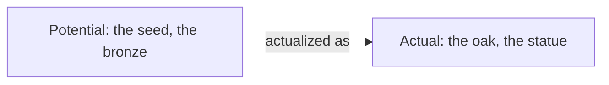

# Potentiality and actuality

**Prerequisites:** [The problem of change](the-problem-of-change.md) and [the four causes](the-four-causes.md)

[Aristotle](../../history/ancient/greek/thinkers/aristotle.md)'s most direct reply to [Parmenides](../../history/ancient/greek/thinkers/parmenides.md) is this: change is not a leap from non-being to being. It is the **actualizing of a potential** already in the thing. A seed is a tree *in potential*; the grown tree is that same thing *in actuality*. Matter is potential relative to form; form is actuality. Motion, in the *Physics*, is the actuality of what is potential as such.

This also lets him handle [Zeno](../../history/ancient/greek/thinkers/zeno-of-elea.md): an infinite division of a path may exist potentially (you can always take a further halfway point) without existing as a completed actual infinity of tasks. Whether that fully answers the paradoxes is still discussed; it is nonetheless a new logical tool.

The same pair structures his psychology and theology: soul as first actuality of a living body; the unmoved mover as pure actuality, a thinking of thinking, with no unrealized potential.

## Key ideas

- Change is the actualizing of a potential, not generation from nothing.
- The distinction structures physics, psychology, and the unmoved mover.
- A potential infinite is Aristotle's main tool against Zeno.

## Where this leads

- [Substance](substance.md)
- Texts: [*Physics*](../../history/ancient/greek/texts/physics.md), [*Metaphysics*](../../history/ancient/greek/texts/metaphysics.md)
- Glossary: [*dynamis*](../../glossary/greek/dynamis.md), [*energeia*](../../glossary/greek/energeia.md)
