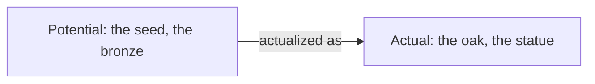

# Potentiality and actuality

**Prerequisites:** [The problem of change](the-problem-of-change.md) and [the four causes](the-four-causes.md)

*Bust of Aristotle. Marble, Roman copy after a Greek bronze original by Lysippos from 330 BC; the alabaster mantle is a modern addition. Credit: After Lysippos. License: Public domain. Source: [File:Aristotle Altemps Inv8575.jpg](https://commons.wikimedia.org/wiki/File:Aristotle_Altemps_Inv8575.jpg).*
[Aristotle](../../history/ancient/greek/thinkers/aristotle.md)'s most direct reply to [Parmenides](../../history/ancient/greek/thinkers/parmenides.md) is this: change is not a leap from non-being to being. It is the **actualizing of a potential** already in the thing. A seed is a tree *in potential*; the grown tree is that same thing *in actuality*. Matter is potential relative to form; form is actuality. Motion, in the *Physics*, is the actuality of what is potential as such.

This also lets him handle [Zeno](../../history/ancient/greek/thinkers/zeno-of-elea.md): an infinite division of a path may exist potentially (you can always take a further halfway point) without existing as a completed actual infinity of tasks. Whether that fully answers the paradoxes is still discussed; it is nonetheless a new logical tool.

The same pair structures his psychology and theology: soul as first actuality of a living body; the unmoved mover as pure actuality, a thinking of thinking, with no unrealized potential.

## Working the idea

Aristotle's *dunamis* and *energeia* (or *entelecheia*) are his most important device for talking about change without surrendering to Parmenides or to a sheer flux. A thing can be actually one thing and potentially another: the bronze is actually bronze and potentially a statue; the builder is potentially building even while sitting, and actually building when at work. Coming-to-be is not a leap from nothing to something. It is the actualization of a potential that was already there, in a matter fit for that form, typically under the influence of something already actual (a sculptor, a parent, a teacher).

The distinction also does ethical and psychological work. The virtuous person has the *capacity* and, more than that, the settled actuality of virtuous action; the learner has a lower-grade potential that needs teaching and habit. In *De Anima*, the soul's powers (nutrition, perception, thought) are analyzed in the same idiom, including the difficult case of the intellect that can become all things. In metaphysics, the unmoved mover is often described as pure actuality, with no remainder of unrealized potential — a way of securing a first cause that does not itself need to be moved or completed.

Common mistakes: treating potential as a ghostly thing already sitting inside the bronze (a little statue waiting), or treating the distinction as a vague synonym for "possible vs. real" in a modern modal sense. Aristotelian potentiality is *specified*: this matter is potential *for* certain forms and not others. An acorn is not a potential ship. When you use the vocabulary, name the "for what," and ask what already-actual thing is doing the work of bringing it about. That is when the device starts to explain, rather than merely to label, a change.

## Key ideas

- Change is the actualizing of a potential, not generation from nothing.
- The distinction structures physics, psychology, and the unmoved mover.
- A potential infinite is Aristotle's main tool against Zeno.

## Where this leads

- [Substance](substance.md)
- Texts: [*Physics*](../../history/ancient/greek/texts/physics.md), [*Metaphysics*](../../history/ancient/greek/texts/metaphysics.md)
- Glossary: [*dynamis*](../../glossary/greek/dynamis.md), [*energeia*](../../glossary/greek/energeia.md)
