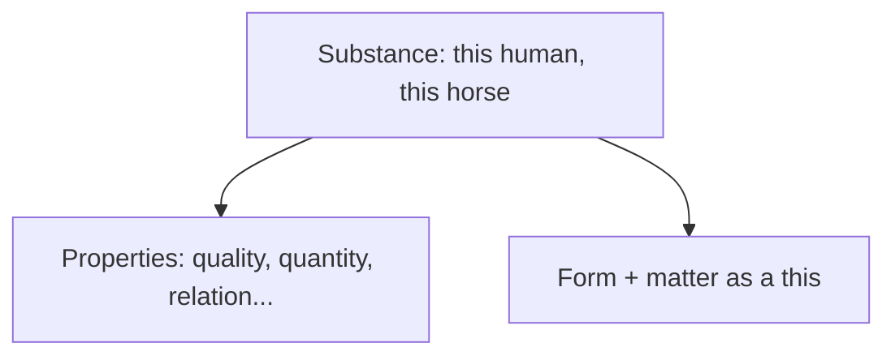

# Substance

**Prerequisites:** [Form and matter](form-and-matter.md)

*Bust of Aristotle. Marble, Roman copy after a Greek bronze original by Lysippos from 330 BC; the alabaster mantle is a modern addition. Credit: After Lysippos. License: Public domain. Source: [File:Aristotle Altemps Inv8575.jpg](https://commons.wikimedia.org/wiki/File:Aristotle_Altemps_Inv8575.jpg).*
*Ousia*, usually translated **substance**, is [Aristotle](../../history/ancient/greek/thinkers/aristotle.md)'s name for what is primarily real: this horse, this person, a "this" that can bear properties and persist through change. In the *Categories*, substance is the subject of predication, not itself predicated of a subject. In the [*Metaphysics*](../../history/ancient/greek/texts/metaphysics.md), the question "what is substance?" becomes harder: is it the composite, the form, or the matter? Form, as actuality and essence, has a strong claim; the living composite is what we meet.

Substance is also Aristotle's alternative to two reductions: [Plato](../../history/ancient/greek/thinkers/plato.md)'s primary beings as separate Forms, and the [atomists](atoms-and-void.md)' primary beings as bits of stuff. A substance is an organized this, often a living this, not a quality, a heap, or a number.

## Working the idea

*Ousia*, usually translated "substance" or "being," is Aristotle's name for the primary answer to "what is there?" In the *Categories*, a primary substance is this particular human being or horse, of which things are said and in which qualities inhere; secondary substances are the species and genus. In the *Metaphysics*, the question becomes harder: is the substance of a thing its matter, its form, the compound, or a universal? Aristotle's settled tendency is to treat form, or the form-of-this-compound, as the strongest candidate for the substance of living things, while still insisting that what we meet in the world are particular compounds.

The Latin "substance" (that which stands under) can mislead. It suggests a bare substratum with properties perched on it. Aristotle does talk about a substratum, but his substances are ordinary complete beings — a tree, a person — not hidden kernels. When early modern philosophers later attack "substance," they are often attacking a scholastic descendant, or a corpuscular stand-in, not the *Categories*' first list.

A way to work the idea: take a familiar object and ask what you are willing to count as *the same thing* through change. If the wood is burned, is the substance gone? If a person learns and ages, what persists? If a statue is recast, is the statue or the bronze the substance? Aristotle's vocabulary is a disciplined way of answering those questions, and of criticizing predecessors who named only matter, or only a detached form. Plato's forms, atomist atoms, and ordinary unanalyzed "things" are all rivals. You will not finish the *Metaphysics* in this lesson; you can learn why the word "substance" in later philosophy is never just furniture.

## Key ideas

- Substance is primary being: a this that underlies change and predication.
- The exact identity of substance (form, composite) is a problem inside the *Metaphysics*.
- It is offered as an alternative to separate Forms and to mere stuff.

## Where this leads

- Text: [*Metaphysics*](../../history/ancient/greek/texts/metaphysics.md)
- Glossary: [*ousia*](../../glossary/greek/ousia.md)
