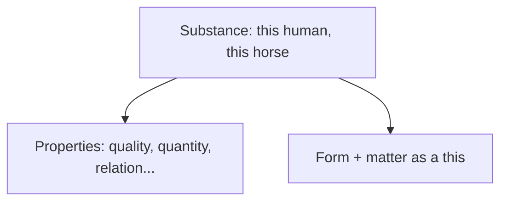

# Substance

**Prerequisites:** [Form and matter](form-and-matter.md)

*Ousia*, usually translated **substance**, is [Aristotle](../../history/ancient/greek/thinkers/aristotle.md)'s name for what is primarily real: this horse, this person, a "this" that can bear properties and persist through change. In the *Categories*, substance is the subject of predication, not itself predicated of a subject. In the [*Metaphysics*](../../history/ancient/greek/texts/metaphysics.md), the question "what is substance?" becomes harder: is it the composite, the form, or the matter? Form, as actuality and essence, has a strong claim; the living composite is what we meet.

Substance is also Aristotle's alternative to two reductions: [Plato](../../history/ancient/greek/thinkers/plato.md)'s primary beings as separate Forms, and the [atomists](atoms-and-void.md)' primary beings as bits of stuff. A substance is an organized this, often a living this, not a quality, a heap, or a number.

## Key ideas

- Substance is primary being: a this that underlies change and predication.
- The exact identity of substance (form, composite) is a problem inside the *Metaphysics*.
- It is offered as an alternative to separate Forms and to mere stuff.

## Where this leads

- Text: [*Metaphysics*](../../history/ancient/greek/texts/metaphysics.md)
- Glossary: [*ousia*](../../glossary/greek/ousia.md)
