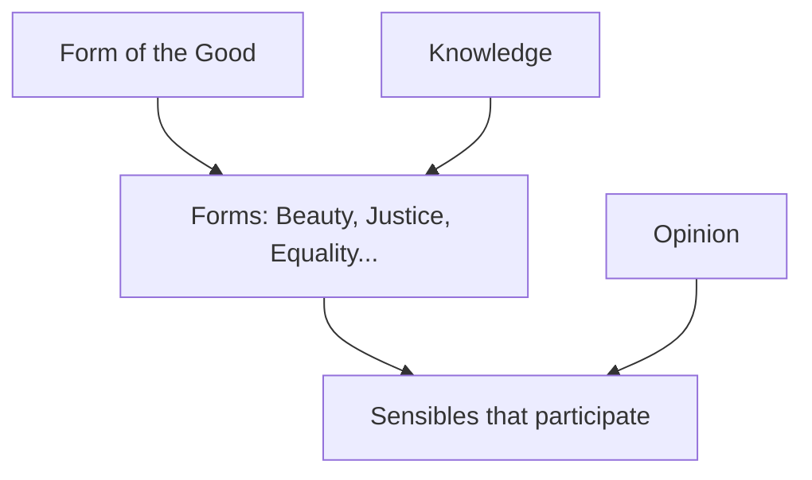

# The Forms

**Prerequisites:** [The problem of change](the-problem-of-change.md) and [Plato](../../history/ancient/greek/thinkers/plato.md)

*Plato, copy of the portrait made by Silanion ca. 370 BC for the Academia in Athens Credit: Marie-Lan Nguyen. License: [CC BY 2.5](https://creativecommons.org/licenses/by/2.5). Source: [File:Plato Silanion Musei Capitolini MC1377.jpg](https://commons.wikimedia.org/wiki/File:Plato_Silanion_Musei_Capitolini_MC1377.jpg).*
The Theory of Forms (*eide*, also "Ideas") is [Plato](../../history/ancient/greek/thinkers/plato.md)'s most famous metaphysical claim. Particular beautiful things are mixed, changing, and perishable. Beauty itself is a stable, intelligible reality that particulars "participate in" or imitate. Knowledge (*episteme*) grasps Forms; opinion (*doxa*) tracks sensibles. In the [*Republic*](../../history/ancient/greek/texts/republic.md), the Form of the Good plays, for intelligibles, a role like the sun's for visibles. The Cave and the divided line are pictures of this epistemology and of education as a turning of the soul.

This is a reply to [the problem of change](the-problem-of-change.md): give knowledge an unchanging object without simply erasing the world we see. It is also a reply to [Parmenides](../../history/ancient/greek/thinkers/parmenides.md), one that keeps a many of intelligible beings rather than a single Parmenidean lump.

The theory is not one frozen dogma. The [*Parmenides*](../../history/ancient/greek/texts/parmenides.md) presses the **third man** and other objections. The [*Sophist*](../../history/ancient/greek/texts/sophist.md) and [*Timaeus*](../../history/ancient/greek/texts/timaeus.md) rework the landscape. [Aristotle](../../history/ancient/greek/thinkers/aristotle.md) accepts the demand for stable objects of knowledge and rejects *separate* Forms, relocating form in [substances](substance.md). [Plotinus](../../history/ancient/greek/thinkers/plotinus.md) places the Forms in Intellect, below the One. "The Theory of Forms" is a family of attempts, and that is the accurate first-principles picture.

## Working the idea

Plato's forms (*eidē*, *ideai*) are offered as the stable objects of knowledge and as the standards by which many changing, perceptible things can be called the same. There is such a thing as the Just itself, the Beautiful itself, not only just acts and beautiful faces. The dialogues do not all present this view in the same way, and a careful reader should not flatten the *Phaedo*, the *Republic*, the *Symposium*, the *Parmenides*, and the *Timaeus* into one pamphlet. Sometimes the form is a cause of a thing's being what it is; sometimes it is what the soul recollects; sometimes it is a paradigm a craftsman-god looks to; sometimes, as in the *Parmenides*, the theory is put under severe pressure (the one-and-many problems, the "third man").

Aristotle's criticisms — that the forms do not explain change, that they double the world, that they cannot be participated in without paradox — set the terms of a long debate. You can learn from the debate without treating Plato as a simple "two-world" dogmatist. Many contemporary readers emphasize the forms as explanatory and normative, or as what a definition aims at, rather than as items in a sky. Other readers insist that Plato really does mean a separate, more real realm. The texts can support a fight; they do not support indifference to the fight.

When you meet an appeal to a form in a dialogue, ask what problem it is there to solve: knowledge versus opinion, the unity of a virtue, the possibility of a standard beyond convention, the order of the cosmos. Then ask what would be lost if one tried to do the same work with names, customs, or particular exemplars only. That is the test of whether the theory is doing philosophical labor or only adding a capital letter to an adjective.

## Key ideas

- Forms are stable intelligible objects; particulars participate in them.
- Knowledge and opinion are split along this line; the Good is the highest in the *Republic*.
- Plato himself, and then Aristotle, test and revise the theory.

## Where this leads

- [Knowledge and opinion](../epistemology/knowledge-and-opinion.md), [form and matter](form-and-matter.md)
- Texts: [*Republic*](../../history/ancient/greek/texts/republic.md), [*Phaedo*](../../history/ancient/greek/texts/phaedo.md), [*Parmenides*](../../history/ancient/greek/texts/parmenides.md)
