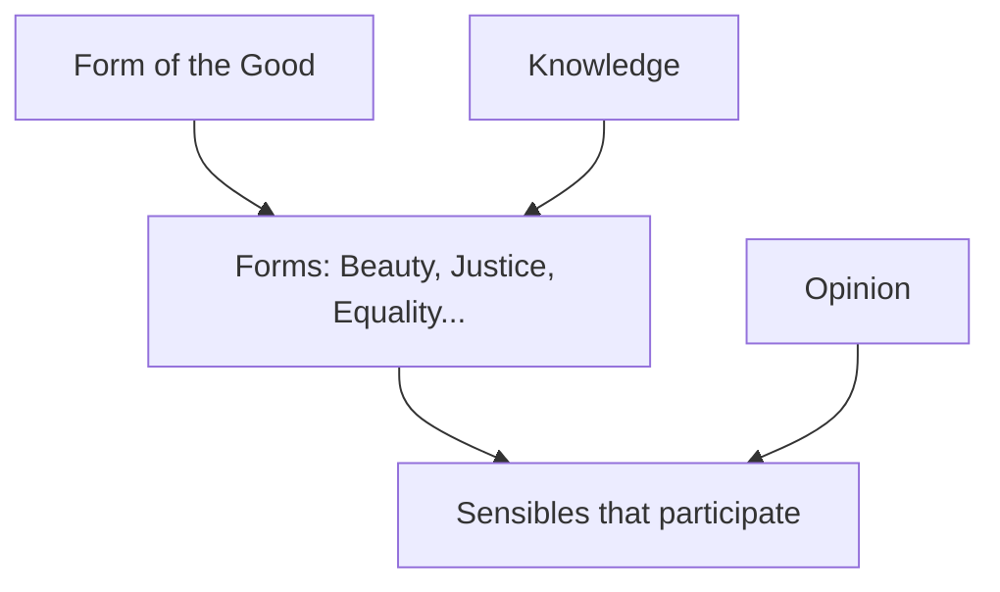

# The Forms

**Prerequisites:** [The problem of change](the-problem-of-change.md) and [Plato](../../history/ancient/greek/thinkers/plato.md)

The Theory of Forms (*eide*, also "Ideas") is [Plato](../../history/ancient/greek/thinkers/plato.md)'s most famous metaphysical claim. Particular beautiful things are mixed, changing, and perishable. Beauty itself is a stable, intelligible reality that particulars "participate in" or imitate. Knowledge (*episteme*) grasps Forms; opinion (*doxa*) tracks sensibles. In the [*Republic*](../../history/ancient/greek/texts/republic.md), the Form of the Good plays, for intelligibles, a role like the sun's for visibles. The Cave and the divided line are pictures of this epistemology and of education as a turning of the soul.

This is a reply to [the problem of change](the-problem-of-change.md): give knowledge an unchanging object without simply erasing the world we see. It is also a reply to [Parmenides](../../history/ancient/greek/thinkers/parmenides.md), one that keeps a many of intelligible beings rather than a single Parmenidean lump.

The theory is not one frozen dogma. The [*Parmenides*](../../history/ancient/greek/texts/parmenides.md) presses the **third man** and other objections. The [*Sophist*](../../history/ancient/greek/texts/sophist.md) and [*Timaeus*](../../history/ancient/greek/texts/timaeus.md) rework the landscape. [Aristotle](../../history/ancient/greek/thinkers/aristotle.md) accepts the demand for stable objects of knowledge and rejects *separate* Forms, relocating form in [substances](substance.md). [Plotinus](../../history/ancient/greek/thinkers/plotinus.md) places the Forms in Intellect, below the One. "The Theory of Forms" is a family of attempts, and that is the accurate first-principles picture.

## Key ideas

- Forms are stable intelligible objects; particulars participate in them.
- Knowledge and opinion are split along this line; the Good is the highest in the *Republic*.
- Plato himself, and then Aristotle, test and revise the theory.

## Where this leads

- [Knowledge and opinion](../epistemology/knowledge-and-opinion.md), [form and matter](form-and-matter.md)
- Texts: [*Republic*](../../history/ancient/greek/texts/republic.md), [*Phaedo*](../../history/ancient/greek/texts/phaedo.md), [*Parmenides*](../../history/ancient/greek/texts/parmenides.md)
