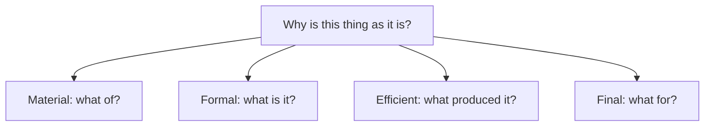

# The four causes

**Prerequisites:** [Form and matter](form-and-matter.md)

*Bust of Aristotle. Marble, Roman copy after a Greek bronze original by Lysippos from 330 BC; the alabaster mantle is a modern addition. Credit: After Lysippos. License: Public domain. Source: [File:Aristotle Altemps Inv8575.jpg](https://commons.wikimedia.org/wiki/File:Aristotle_Altemps_Inv8575.jpg).*
To explain something fully, [Aristotle](../../history/ancient/greek/thinkers/aristotle.md) says, is to give four kinds of "because": **material** (what it is made of), **formal** (what it is, its structure or definition), **efficient** (what brought it about), and **final** (what it is for, its [*telos*](../../glossary/greek/telos.md)). A house has timber, a design, a builder, and the purpose of shelter. A living organ has a material makeup, a form, a process of growth, and a function.

Natural things, in this picture, are thoroughly teleological. An acorn is intelligible as something on the way to being an oak. Modern natural science officially dropped final causes as explanations of non-human nature; that is a real break, and it is also why Aristotle's biology and physics can look alien. The four-cause scheme is still a useful first-principles checklist: if you have only matter and a push, you may have left out what the thing *is* and what it is *for*.

## Working the idea

Aristotle's four causes (*aitiai*) are four answers to "why?" or "because of what?" that together make a thing intelligible. The material cause is that out of which (bronze, syllables, the body). The formal cause is the what-it-is-to-be (the shape of the statue, the definition, the soul as form of a living body). The efficient (moving) cause is that from which change begins (the sculptor, the father, the advice that starts a choice). The final cause is that for the sake of which (health as the end of walking, the function of an organ, the good at which an art aims). A complete explanation of a statue, a house, or a living being typically involves all four.

The vocabulary of "cause" in English can sound like a search for a push, so students over-weight the efficient cause and then find the others quaint. For Aristotle, a why-question is not only "what knocked it?" It is also "what is it?", "what is it made of?", and "what is it for?" Natural things, in his biology and physics, are especially ordered to ends, without his meaning (in the usual reading) that every tree has a plan in a mind. Art imitates nature in having ends; nature has them as part of what it is to be that kind of thing.

A useful exercise is to explain one artifact and one organism in all four registers, and then to notice which register a later scientific style drops. Early modern mechanics often keeps matter and mover and drops, or redesigns, form and end. Biology keeps rediscovering functional talk even when official method is shy of it. You need not restore Aristotelian science wholesale to see why he thought a one-cause story was a thinner account than it appeared.

## Key ideas

- Four "becauses": material, formal, efficient, final.
- Natural things are explained teleologically in Aristotle.
- The scheme is a map of explanation, later partly rejected by modern physics.

## Where this leads

- [Potentiality and actuality](potentiality-and-actuality.md)
- Texts: [*Physics*](../../history/ancient/greek/texts/physics.md), [*Metaphysics*](../../history/ancient/greek/texts/metaphysics.md)
- Glossary: [*telos*](../../glossary/greek/telos.md), [*aitia*](../../glossary/greek/aitia.md)
