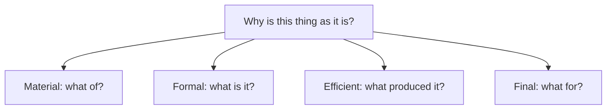

# The four causes

**Prerequisites:** [Form and matter](form-and-matter.md)

To explain something fully, [Aristotle](../../history/ancient/greek/thinkers/aristotle.md) says, is to give four kinds of "because": **material** (what it is made of), **formal** (what it is, its structure or definition), **efficient** (what brought it about), and **final** (what it is for, its [*telos*](../../glossary/greek/telos.md)). A house has timber, a design, a builder, and the purpose of shelter. A living organ has a material makeup, a form, a process of growth, and a function.

Natural things, in this picture, are thoroughly teleological. An acorn is intelligible as something on the way to being an oak. Modern natural science officially dropped final causes as explanations of non-human nature; that is a real break, and it is also why Aristotle's biology and physics can look alien. The four-cause scheme is still a useful first-principles checklist: if you have only matter and a push, you may have left out what the thing *is* and what it is *for*.

## Key ideas

- Four "becauses": material, formal, efficient, final.
- Natural things are explained teleologically in Aristotle.
- The scheme is a map of explanation, later partly rejected by modern physics.

## Where this leads

- [Potentiality and actuality](potentiality-and-actuality.md)
- Texts: [*Physics*](../../history/ancient/greek/texts/physics.md), [*Metaphysics*](../../history/ancient/greek/texts/metaphysics.md)
- Glossary: [*telos*](../../glossary/greek/telos.md), [*aitia*](../../glossary/greek/aitia.md)
