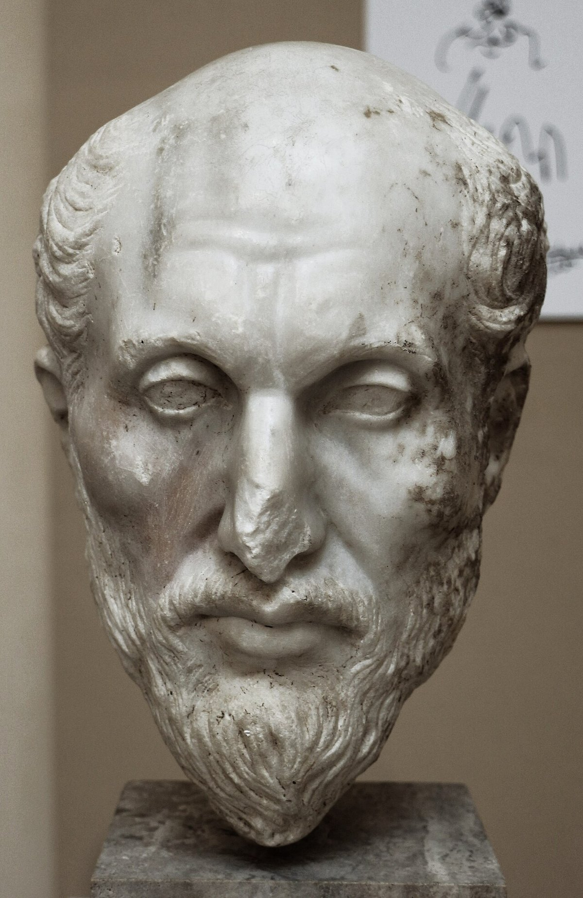
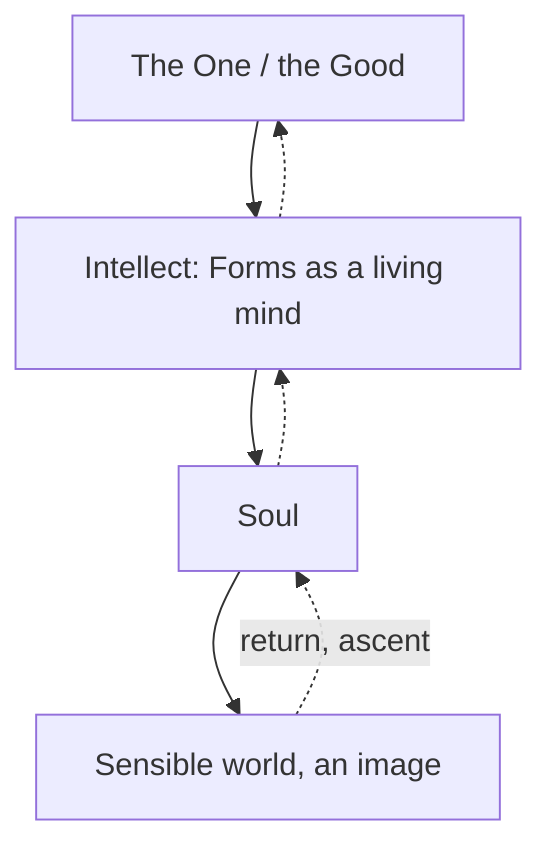

# The One and emanation

**Prerequisites:** [The Forms](the-forms.md) and [Plotinus](../../history/ancient/greek/thinkers/plotinus.md)

*Ancient Roman bust in the Museo Ostiense (Ostia Antica). Marble head. Ostia Antica, Museo, inv. 1386. Neck broken along line of beard. Tip of nose and part… Credit: Sailko. License: [CC BY 3.0](https://creativecommons.org/licenses/by/3.0). Source: [File:Head of Plotinus, Museo Ostiense inv.JPG](https://commons.wikimedia.org/wiki/File:Head_of_Plotinus,_Museo_Ostiense_inv.JPG).*
[Plotinus](../../history/ancient/greek/thinkers/plotinus.md) recasts Platonic metaphysics as a hierarchy of **procession and return**. The **One** (the Good) is beyond being and description. From it, without any lessening, proceeds **Intellect** (*Nous*), which is also the realm of Forms. From Intellect proceeds **Soul**, which can turn up toward Intellect or out toward the sensible world. Matter stands at the far edge as impoverishment, not as a rival first principle. The structure is always so; it is not a creation story with a date.

The ethical point is the soul's return: purification, dialectic, and a turning inward whose end is union, or likeness, with the source. Plotinus defends the beauty of the sensible cosmos against Gnostic rejection: it is an image of Intellect, not a waste. This late ancient system is how much of Plato traveled into medieval philosophy.

## Working the idea

Plotinus' One is not a number and not a god among gods. It is the source beyond being and intellect, from which, without loss or motion in the source itself, Intellect (*nous*) and then Soul and then the sensible world proceed. "Emanation" is a later teaching word for that procession; Plotinus himself prefers images of overflow, of light from the sun, of a spring that is not diminished by flowing. The point of the images is a philosophical one: the lower depends on the higher and the higher is not used up, so the One remains simple. Multiplicity begins with Intellect, which thinks the forms, a one-many. Soul mediates between the intelligible and the bodily. Return is possible because the soul can turn inward and upward, by purification and by intellect, toward its source.

This is a reshaping of Plato, not a footnote. The *Parmenides* and the *Republic*'s Good beyond being are decisive backgrounds, as is a long Hellenistic argument about how a first principle can be simple and yet give rise to a many. Plotinus is also arguing against gnostic contempt for the sensible cosmos: the world, though lower, is an image and not a catastrophe. Reading the *Enneads* therefore requires both a metaphysical ear (unity, procession, return) and an ethical one (what kind of life turns the soul the right way).

When you compare this scheme with a biblical or later Christian doctrine of creation, keep the differences visible. Emanation, in this Neoplatonic form, is not a free decision in time to make a world from nothing; it is the eternal, necessary overflow of a source that remains itself. Later Christian Platonists will both use and revise this language. The lesson's job is to make Plotinus' own structure clear before those revisions arrive.

## Key ideas

- A graded procession: One, Intellect, Soul, with the sensible as image.
- Forms live in Intellect; the One is prior even to thinking.
- Philosophy includes the soul's ascent, not only a theory of levels.

## Where this leads

- Text: [*Enneads*](../../history/ancient/greek/texts/enneads.md)
- Thinker: [Plotinus](../../history/ancient/greek/thinkers/plotinus.md)
- Glossary: [*nous*](../../glossary/greek/nous.md), [emanation](../../glossary/general/emanation.md)
