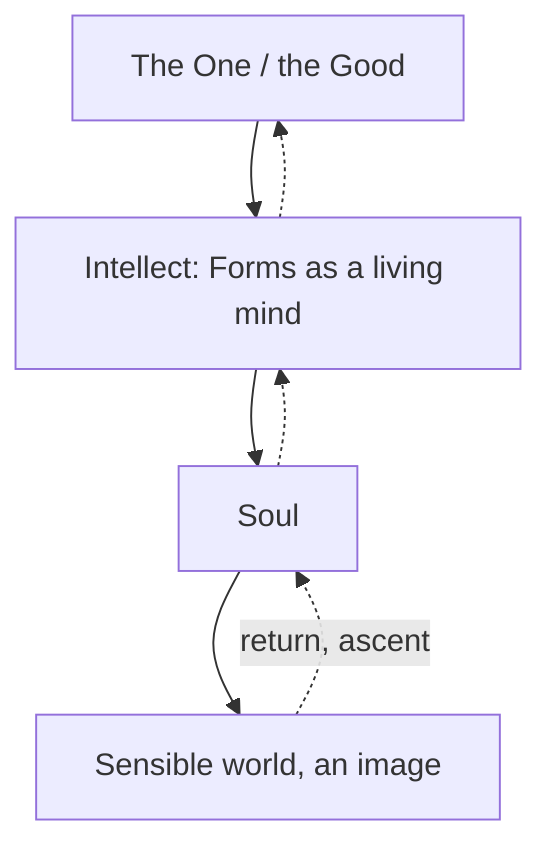

# The One and emanation

**Prerequisites:** [The Forms](the-forms.md) and [Plotinus](../../history/ancient/greek/thinkers/plotinus.md)

[Plotinus](../../history/ancient/greek/thinkers/plotinus.md) recasts Platonic metaphysics as a hierarchy of **procession and return**. The **One** (the Good) is beyond being and description. From it, without any lessening, proceeds **Intellect** (*Nous*), which is also the realm of Forms. From Intellect proceeds **Soul**, which can turn up toward Intellect or out toward the sensible world. Matter stands at the far edge as impoverishment, not as a rival first principle. The structure is always so; it is not a creation story with a date.

The ethical point is the soul's return: purification, dialectic, and a turning inward whose end is union, or likeness, with the source. Plotinus defends the beauty of the sensible cosmos against Gnostic rejection: it is an image of Intellect, not a waste. This late ancient system is how much of Plato traveled into medieval philosophy.

## Key ideas

- A graded procession: One, Intellect, Soul, with the sensible as image.
- Forms live in Intellect; the One is prior even to thinking.
- Philosophy includes the soul's ascent, not only a theory of levels.

## Where this leads

- Text: [*Enneads*](../../history/ancient/greek/texts/enneads.md)
- Thinker: [Plotinus](../../history/ancient/greek/thinkers/plotinus.md)
- Glossary: [*nous*](../../glossary/greek/nous.md), [emanation](../../glossary/general/emanation.md)
