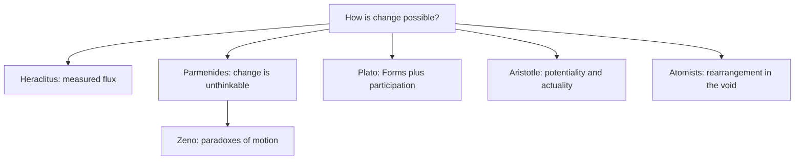

# The problem of change

**Prerequisites:** [*Arche* and first principles](arche-and-first-principles.md)

Everyday life is full of change: a seed becomes a tree, a person grows old, fire consumes wood. The philosophical problem is not that change happens. It is how change is possible without contradiction, and how knowledge is possible if things will not stay put.

Two pressures pull in opposite directions. If you emphasize flux, you get something like [Heraclitus](../../history/ancient/greek/thinkers/heraclitus.md): the world is process, a river you cannot step into twice. But then what do our words latch onto, and how is knowledge more than a snapshot of something already gone? If you emphasize stability, you get [Parmenides](../../history/ancient/greek/thinkers/parmenides.md): what-is is, and cannot not be; coming-to-be looks like a confusion that talks about what-is-not. [Zeno](../../history/ancient/greek/thinkers/zeno-of-elea.md) sharpens the second pressure into paradoxes of motion.

Later Greek philosophy is, in large part, a set of replies. [Plato](../../history/ancient/greek/thinkers/plato.md)'s [Forms](the-forms.md) give knowledge a stable object, while sensibles "participate" in it. [Aristotle](../../history/ancient/greek/thinkers/aristotle.md)'s [potentiality and actuality](potentiality-and-actuality.md) let a seed *be* a tree potentially, so becoming is not a leap from non-being. The [atomists](atoms-and-void.md) keep unchanging beings (atoms) and allow change as rearrangement in the void. These are not three ways of saying the same thing. They are three prices you can pay to keep both a world that changes and a thought that holds.

The Chinese path is less often gripped by "is change real?" because process is assumed; the work goes into how change is *patterned* — [Dao](dao-as-way-and-source.md), [yin-yang](yin-yang-and-correlative-cosmology.md), the [*Changes*](../../history/ancient/chinese/texts/i-ching.md). That is a different center of gravity, not an absence of metaphysics.

## Key ideas

- The problem is how to think change without wrecking knowledge or contradicting "what is."
- Heraclitus and Parmenides set the dilemma; later systems are replies.
- Process traditions can shift the question from "whether" to "how change is patterned."

## Where this leads

- [Being and not-being](being-and-not-being.md), [potentiality and actuality](potentiality-and-actuality.md), [the Forms](the-forms.md)
- Survey: [foundational Greek concepts](../../history/ancient/greek/01-foundational-concepts.md)
