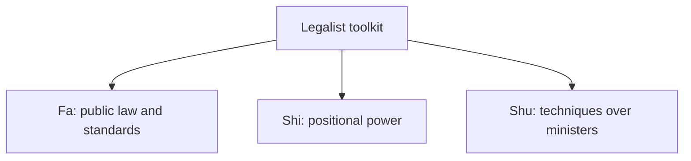

# *Fa*, *shi*, and *shu*

**Prerequisites:** [Han Feizi](../../history/ancient/chinese/thinkers/han-feizi.md) and [government by virtue](government-by-virtue.md)

*The teaching Confucius. Portrait by Wu Daozi, 685-758, Tang Dynasty. Credit: Wu Daozi, 685-758, Tang Dynasty.. License: Public domain. Source: [File:Confucius Tang Dynasty.jpg](https://commons.wikimedia.org/wiki/File:Confucius_Tang_Dynasty.jpg).*
The Legalist toolkit, synthesized in the [*Han Feizi*](../../history/ancient/chinese/texts/han-feizi.md), has three parts. **[*Fa*](../../glossary/chinese/fa.md)** is law or public standard: clear, relatively impersonal rewards and punishments, actually applied. **[*Shi*](../../glossary/chinese/shi-positional-power.md)** is the power of the position, so that the seat, not the occupant's virtue, carries authority. **[*Shu*](../../glossary/chinese/shu-technique.md)** is administrative technique for appointing and monitoring officials. The bet is that people follow interest, and that a state must be designed for the people it has, not for sages.

This is not liberal rule of law. Law is an instrument of state strength; the ruler stands at the apex. Qin made the program historically real and historically brief. The first-principles contrast with [government by virtue](government-by-virtue.md) should stay sharp, without turning Legalism into a cartoon of cruelty or Confucianism into a cartoon of softness.

## Working the idea

Legalism is often summarized as "harsh law," which is half a truth and a bad starting point. In the *Han Feizi* and related texts, three tools are braided. *Fa* is law or standard: clear, public, impersonal measures of reward and punishment, so that ministers cannot hide in the fog of moral prestige. *Shi* is positional power: the authority that belongs to the throne as a place, not to the charisma or virtue of the individual sitting in it. A weak man in the right position, with the right system, can rule; a sage without position cannot. *Shu* is the set of techniques and methods by which a ruler handles personnel — holding names to performances, concealing desires, preventing cliques — so that the system is not captured from within.

The moral shock of these texts is deliberate. They distrust talk of *ren* and of the ancient kings as a political technology for the late Warring States, a period of spies, large armies, and ministers who can empty a state from the inside. Their wager is that a well-designed automatic order beats a hope of virtuous persons. Confucian and later readers call this cold, and it is. It is also an analysis of principal-agent problems that modern political theory still recognizes, even when it rejects the cruelty and the cult of the autocrat's secrecy.

When you read, keep the three terms distinct. A passage about harsh penalties is about *fa*; a passage about why the ruler must not share his "handles" of life and death is about *shi* and *shu*. Then ask what problem of the age the author thinks ritual and example cannot solve. You may still prefer a government-by-virtue ideal after that. You will prefer it with a clearer sense of the objection it has to meet.

## Key ideas

- Law, position, and technique are meant to replace reliance on sagehood.
- Legalism is rule *by* law as an instrument, not liberal rule of law.
- Qin's rise and collapse are part of the tradition's meaning.

## Where this leads

- Thinkers: [Shang Yang](../../history/ancient/chinese/thinkers/shang-yang.md), [Han Feizi](../../history/ancient/chinese/thinkers/han-feizi.md)
- Contrast: [government by virtue](government-by-virtue.md)
