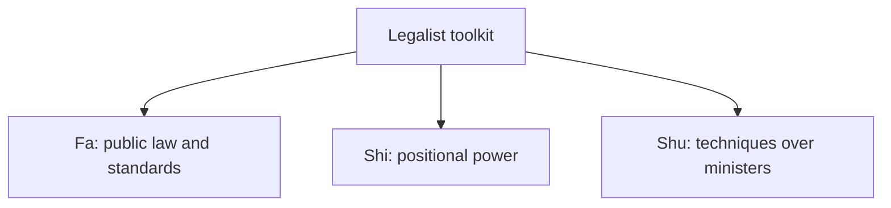

# *Fa*, *shi*, and *shu*

**Prerequisites:** [Han Feizi](../../history/ancient/chinese/thinkers/han-feizi.md) and [government by virtue](government-by-virtue.md)

The Legalist toolkit, synthesized in the [*Han Feizi*](../../history/ancient/chinese/texts/han-feizi.md), has three parts. **[*Fa*](../../glossary/chinese/fa.md)** is law or public standard: clear, relatively impersonal rewards and punishments, actually applied. **[*Shi*](../../glossary/chinese/shi-positional-power.md)** is the power of the position, so that the seat, not the occupant's virtue, carries authority. **[*Shu*](../../glossary/chinese/shu-technique.md)** is administrative technique for appointing and monitoring officials. The bet is that people follow interest, and that a state must be designed for the people it has, not for sages.

This is not liberal rule of law. Law is an instrument of state strength; the ruler stands at the apex. Qin made the program historically real and historically brief. The first-principles contrast with [government by virtue](government-by-virtue.md) should stay sharp, without turning Legalism into a cartoon of cruelty or Confucianism into a cartoon of softness.

## Key ideas

- Law, position, and technique are meant to replace reliance on sagehood.
- Legalism is rule *by* law as an instrument, not liberal rule of law.
- Qin's rise and collapse are part of the tradition's meaning.

## Where this leads

- Thinkers: [Shang Yang](../../history/ancient/chinese/thinkers/shang-yang.md), [Han Feizi](../../history/ancient/chinese/thinkers/han-feizi.md)
- Contrast: [government by virtue](government-by-virtue.md)
