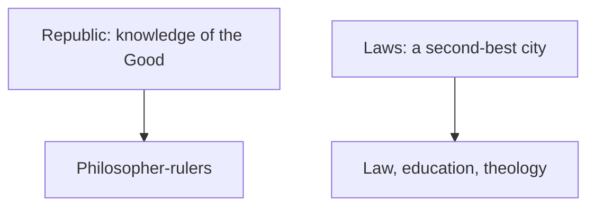

# Philosopher-rulers

**Prerequisites:** [*Republic*](../../history/ancient/greek/texts/republic.md)

In [Plato](../../history/ancient/greek/thinkers/plato.md)'s [*Republic*](../../history/ancient/greek/texts/republic.md), the just city requires **philosophers to rule**, or rulers to philosophize, because only those who have turned toward the [Forms](../metaphysics/the-forms.md) and the Good can see what is truly beneficial, not only what appears so. The proposal travels with a severe education, a "noble lie," and, among the guardians, common property and family. Whether this is a blueprint, a thought-experiment, a critique of existing politics after [Socrates](../../history/ancient/greek/thinkers/socrates.md)' death, or a model primarily for the soul is a standing dispute.

The [*Laws*](../../history/ancient/greek/texts/laws.md) designs a second-best city in which law, habit, and theology do more of the work. [Aristotle](../../history/ancient/greek/thinkers/aristotle.md) criticizes the *Republic*'s institutions in the *Politics*. The first-principles question that remains is: if knowledge of the good is rare, who should have power, and what can law do when sages are not on the throne?

## Key ideas

- The *Republic* ties just rule to philosophical knowledge of the Good.
- How literally to take the city in speech is an open question.
- The *Laws* and Aristotle offer less sage-dependent alternatives.

## Where this leads

- [Government by virtue](government-by-virtue.md) as a Confucian cousin
- Texts: [*Republic*](../../history/ancient/greek/texts/republic.md), [*Laws*](../../history/ancient/greek/texts/laws.md)
