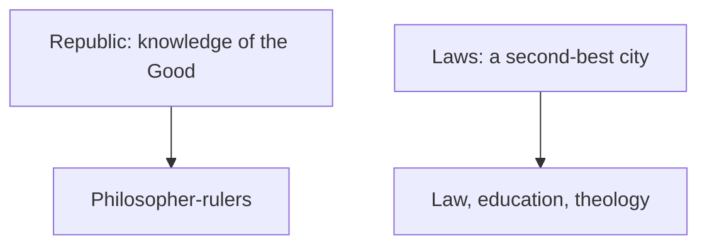

# Philosopher-rulers

**Prerequisites:** [*Republic*](../../history/ancient/greek/texts/republic.md)

*Bust of Aristotle. Marble, Roman copy after a Greek bronze original by Lysippos from 330 BC; the alabaster mantle is a modern addition. Credit: After Lysippos. License: Public domain. Source: [File:Aristotle Altemps Inv8575.jpg](https://commons.wikimedia.org/wiki/File:Aristotle_Altemps_Inv8575.jpg).*
In [Plato](../../history/ancient/greek/thinkers/plato.md)'s [*Republic*](../../history/ancient/greek/texts/republic.md), the just city requires **philosophers to rule**, or rulers to philosophize, because only those who have turned toward the [Forms](../metaphysics/the-forms.md) and the Good can see what is truly beneficial, not only what appears so. The proposal travels with a severe education, a "noble lie," and, among the guardians, common property and family. Whether this is a blueprint, a thought-experiment, a critique of existing politics after [Socrates](../../history/ancient/greek/thinkers/socrates.md)' death, or a model primarily for the soul is a standing dispute.

The [*Laws*](../../history/ancient/greek/texts/laws.md) designs a second-best city in which law, habit, and theology do more of the work. [Aristotle](../../history/ancient/greek/thinkers/aristotle.md) criticizes the *Republic*'s institutions in the *Politics*. The first-principles question that remains is: if knowledge of the good is rare, who should have power, and what can law do when sages are not on the throne?

## Working the idea

In the *Republic*, the claim that cities will not have rest from evils until philosophers rule, or rulers genuinely philosophize, is the hinge of the political argument and the most baited hook in the book. It is easily turned into a cartoon of professors on thrones. Plato's philosophers are not specialists in a modern faculty. They are people whose education has turned their souls toward what is, who know the Good, and who therefore can take the city's order as an image of a more stable order, rather than as a tool for their own faction. They rule unwillingly, as a necessity and a duty to the city that educated them, not as a prize.

The surrounding architecture matters. The proposal comes after a long formation of the soul and of the guardian class, and it is coupled with institutions (property, family, education) that later readers, including Aristotle, find costly or impossible. The *Republic* itself contains images (the cave, the ship of state) that admit how little a democratic assembly may want such a ruler, and the later *Laws* designs a second-best city heavier on law and on a more widely shared piety. So "philosopher-kings" is not Plato's only political word, and it is not a simple policy memo.

Work the idea by asking what *knowledge* is supposed to do that opinion and ambition cannot: settle the measure of justice, resist the lure of honor and money, see the city's good as a whole. Then ask the liberal and the Aristotelian questions: who educates the educators, what checks the rulers, and is political excellence the same as philosophical excellence? Those questions do not dismiss the *Republic*. They are the questions the book, and its sequels, already force.

## Key ideas

- The *Republic* ties just rule to philosophical knowledge of the Good.
- How literally to take the city in speech is an open question.
- The *Laws* and Aristotle offer less sage-dependent alternatives.

## Where this leads

- [Government by virtue](government-by-virtue.md) as a Confucian cousin
- Texts: [*Republic*](../../history/ancient/greek/texts/republic.md), [*Laws*](../../history/ancient/greek/texts/laws.md)
