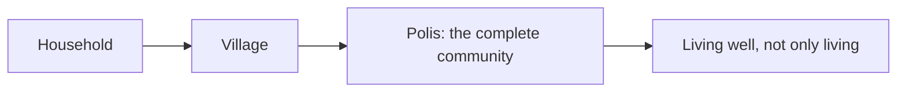

# The *polis* and the political animal

**Prerequisites:** [Aristotle](../../history/ancient/greek/thinkers/aristotle.md) and the [*Politics*](../../history/ancient/greek/texts/politics.md)

[Aristotle](../../history/ancient/greek/thinkers/aristotle.md) calls the human being a *zoon politikon*, a **political animal**: we are the animals who live in a *polis* and who have *logos* about the advantageous and the just. The city exists by nature as the complete community aimed at living well, not only at living. This is the political face of his [teleology](../metaphysics/the-four-causes.md) and of his [ethics](../ethics/eudaimonia.md): flourishing has conditions the household alone cannot supply.

The claim is not a modern theory of the nation-state, and it arrives with serious moral failures in the same book, including the defense of natural slavery. Read the "political animal" as a thesis about speech, community, and the good life, and read the exclusions as part of the same work, not as accidents.

## Key ideas

- Humans are political animals because they have *logos* about justice and live in a *polis*.
- The city exists for living well; it is "natural" in Aristotle's teleological sense.
- The same treatise's exclusions (slavery, women) belong to the reading, not the margins.

## Where this leads

- [Philosopher-rulers](philosopher-rulers.md)
- Text: [*Politics*](../../history/ancient/greek/texts/politics.md)
- Glossary: [*zoion-politikon*](../../glossary/greek/zoion-politikon.md)
