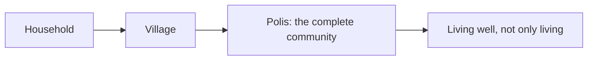

# The *polis* and the political animal

**Prerequisites:** [Aristotle](../../history/ancient/greek/thinkers/aristotle.md) and the [*Politics*](../../history/ancient/greek/texts/politics.md)

*Bust of Aristotle. Marble, Roman copy after a Greek bronze original by Lysippos from 330 BC; the alabaster mantle is a modern addition. Credit: After Lysippos. License: Public domain. Source: [File:Aristotle Altemps Inv8575.jpg](https://commons.wikimedia.org/wiki/File:Aristotle_Altemps_Inv8575.jpg).*
[Aristotle](../../history/ancient/greek/thinkers/aristotle.md) calls the human being a *zoon politikon*, a **political animal**: we are the animals who live in a *polis* and who have *logos* about the advantageous and the just. The city exists by nature as the complete community aimed at living well, not only at living. This is the political face of his [teleology](../metaphysics/the-four-causes.md) and of his [ethics](../ethics/eudaimonia.md): flourishing has conditions the household alone cannot supply.

The claim is not a modern theory of the nation-state, and it arrives with serious moral failures in the same book, including the defense of natural slavery. Read the "political animal" as a thesis about speech, community, and the good life, and read the exclusions as part of the same work, not as accidents.

## Working the idea

Aristotle's claim that a human being is a *politikon zōon*, a political or city-animal, is not a compliment paid to extroverts. It is a claim about what kind of living thing we are. We have speech (*logos*) that can make the just and the unjust, the advantageous and the harmful, common; we become fully ourselves only in a *polis*, a self-sufficient civic community of households and villages ordered to the good life, not merely to life. A person without a city is, in the famous phrase, either a beast or a god. The household is a real natural community, but it is not yet the complete one; mastery in the house is not the same as citizenship.

This sets up a distinctive political science. Constitutions are judged by whether they aim at the common advantage and by how many rule (one, few, many), yielding the familiar pairs: kingship/tyranny, aristocracy/oligarchy, polity/democracy. The best practicable arrangement, for Aristotle, often looks like a mixed "polity" with a strong middle, not the *Republic*'s radical redesign. Slavery, the exclusion of women from citizenship, and the tight identity of citizen and warrior-statesman are parts of his picture that later readers must face without anachronistic cleanup and without casual endorsement. They show how his "nature" can underwrite hierarchies as well as civic friendship.

Use the idea as a lens: when a later theory treats politics as a contract among pre-existing individuals, or as administration of an empire, or as an extension of the family, it is departing from this *polis*-centered anthropology. Chinese political thought, organized around realm, household, and the virtue of the ruler rather than around a civic assembly of equals, is a genuine alternative, not a failed *polis*. Comparison starts after both objects are in view.

## Key ideas

- Humans are political animals because they have *logos* about justice and live in a *polis*.
- The city exists for living well; it is "natural" in Aristotle's teleological sense.
- The same treatise's exclusions (slavery, women) belong to the reading, not the margins.

## Where this leads

- [Philosopher-rulers](philosopher-rulers.md)
- Text: [*Politics*](../../history/ancient/greek/texts/politics.md)
- Glossary: [*zoion-politikon*](../../glossary/greek/zoion-politikon.md)
