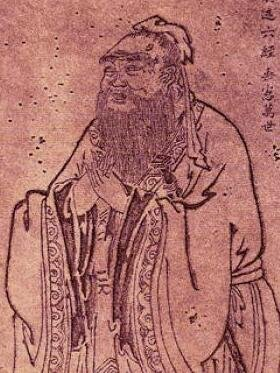
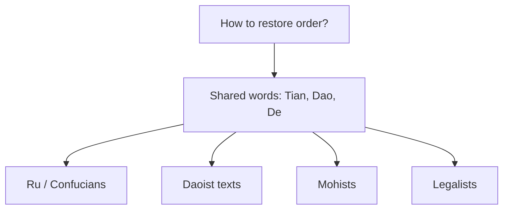

# Foundational concepts: *Tian*, *Dao*, *De*, and the Hundred Schools

**Prerequisites:** [Ancient Chinese philosophy](README.md)
**Key ideas:** *Tian* as heaven and moral-cosmic order; *Dao* as way or path; *De* as virtue, potency, or obtained power; the Hundred Schools as a response to Zhou breakdown.

*The teaching Confucius. Portrait by Wu Daozi, 685-758, Tang Dynasty. Credit: Wu Daozi, 685-758, Tang Dynasty.. License: Public domain. Source: [File:Confucius Tang Dynasty (cropped).jpg](https://commons.wikimedia.org/wiki/File:Confucius_Tang_Dynasty_(cropped).jpg).*
Three words appear across almost every early Chinese school, with different meanings in each. Learning the words first prevents the later lesson from sounding like a string of untranslatable nouns.

## *Tian* (Heaven)

*Tian* can mean the sky, the order of the world, a providential power, or the source of a mandate to rule. In early Zhou ideology, Heaven grants a **Mandate** (*Tianming*) to a virtuous dynasty and can withdraw it from a corrupt one. That idea already ties cosmology to politics: the right to rule is not sheer force, and it is not immune to moral failure.

Different schools then argue about what Heaven is. For Mozi, Heaven has a will that can be known and that endorses impartial care. For Xunzi, Heaven is more like a regular natural order — it does not intervene to reward and punish, and human order is our work, not Heaven's gift in the moment. Confucians often treat Heaven as a moral horizon (the junzi stands in awe of Heaven's mandate) without developing a theology in the biblical sense. When you see "Heaven" in a translation, ask which of these is in play. It is usually not "God" as in Genesis, and it is not mere weather.

## *Dao* (the Way)

*Dao* literally means a road or path, and by extension a way of doing something, a teaching, or the way the world itself operates. Every school claims a *dao*. Confucians speak of the way of the former kings, the way of ritual and humaneness. Legalists offer a way of the state. The *Daodejing* uses the word in a more radical sense: the *Dao* that can be spoken is not the constant *Dao*; there is a source or process prior to named things, from which the ten thousand things arise.

So *Dao* is not automatically "Daoism." It is the general word for the right path and, in some texts, for the deep structure of reality. Comparing it to the Greek *logos* can be suggestive (both can mean the intelligible order of things) and misleading (the *Daodejing*'s Way is often described as emptying names, not as an account you can fully state). Hold the comparison lightly until you have both vocabularies; then see [the comparison essay](../greek-and-chinese-compared.md).

## *De* (virtue, potency)

*De* is often translated "virtue," and in Confucian contexts that is often right: a cultivated moral power that attracts and transforms without coercion. But *De* also means an efficacy or potency you "obtain" (the words are related): the power a thing has when it is as it should be. In the *Daodejing*, the person or ruler who stays close to the *Dao* has *De* of a distinctive kind — unforced, like water finding a course.

Reading *De* only as "being a good person" flattens this. Sometimes it is moral character. Sometimes it is the almost magnetic effectiveness that character (or attunement) is supposed to produce. Political thought in this tradition is obsessed with that effectiveness: how a ruler or a teacher changes people without having to stand over them with a stick. Legalists will later say that this is not reliable, and that law and position must do the work instead.

## The Hundred Schools context

The "Hundred Schools of Thought" names the intellectual ferment of the Warring States period (commonly dated 475–221 BCE), with roots earlier in the Spring and Autumn period. It is not literally a count of a hundred organized departments. It is a way of saying that many masters (*zi*) offered rival arts of order.

The crisis is concrete: interstate war, social mobility that unsettled ranks, and a sense that inherited ritual was either hollow or essential (or both). "Philosophers" in this world are often also would-be advisors. They travel between courts. A theory of human nature is also a proposal for education and law. A theory of names is also a proposal for administration.

The main families you will meet on this path:

- **Ru** (Confucians): cultivate persons and restore ritual-moral order.
- **Daoist** texts (a later grouping of Laozi and Zhuangzi, among others): critique artificial striving; align with a more primordial Way.
- **Mohists:** impartial care, frugality, a standard from Heaven, opposition to aggressive war.
- **Legalists:** clear laws, administrative technique, and the power of position, not moral example, as the basis of a strong state.

Yin-Yang and Five Phases thought is less a single "school" in the same sense and more a cosmology that many later writers used to organize nature, the body, and the state.

The first-principles point is simple: start with the shared problem (order after breakdown) and the shared words (*Tian*, *Dao*, *De*). The schools then become competing specifications of those words.

## Where this leads

- Next: [Confucius and the *Analects*](02-confucius-and-the-analects.md)
- For a Greek analogue to "shared problem, rival schools," see [foundational concepts](../greek/01-foundational-concepts.md) and the [Hellenistic schools](../greek/06-hellenistic-schools.md)
