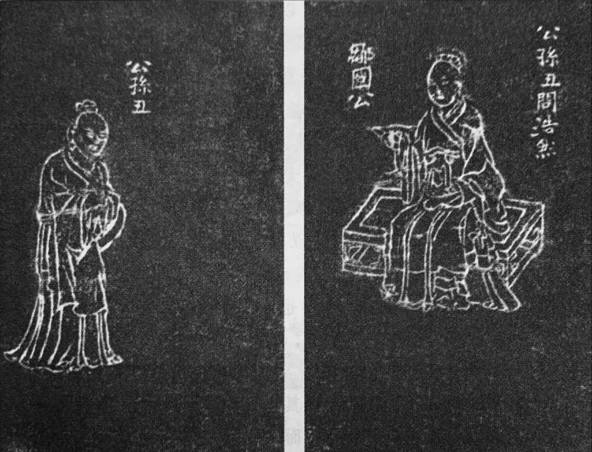
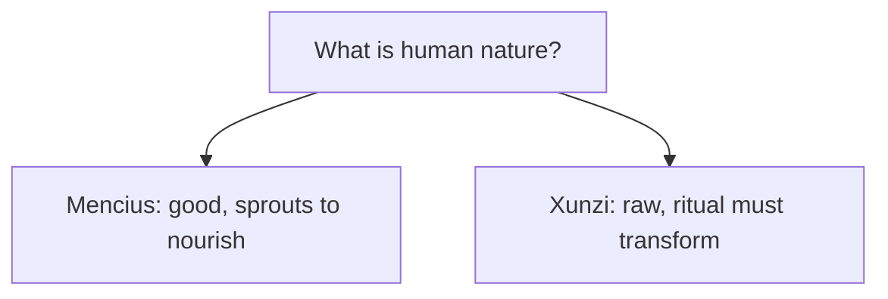

# Mencius and Xunzi on human nature

**Prerequisites:** [Confucius and the *Analects*](02-confucius-and-the-analects.md)
**Key ideas:** both are Confucians; the argument is about *xing* (human nature) and therefore about education and politics; Mencius's moral "sprouts"; Xunzi's claim that nature is raw or bad and that ritual transforms it.

*Gongsun Chou Wen Hao Ran (公孫丑問浩然), depicted the portrait of Mencius (right) and his student Gongsun, Chou (left). The illustration was a rubbing of a stone… Credit: Unknown authorUnknown author. License: Public domain. Source: [File:Gongsun Chou Wen Hao Ran, Heritage Illustrations for Descent of Mencius.jpg](https://commons.wikimedia.org/wiki/File:Gongsun_Chou_Wen_Hao_Ran,_Heritage_Illustrations_for_Descent_of_Mencius.jpg).*
The most important argument inside early Confucianism is not with a Daoist. It is between two heirs of Confucius: Mengzi (Mencius, fourth century BCE) and Xunzi (third century BCE). They agree that ritual, learning, and rightness matter, and that a good order depends on cultivated persons. They disagree about what we are starting with. That disagreement is metaphysics, ethics, and pedagogy at once.

## Mencius: nature is good

Mencius argues that human nature (*xing*) is good. He does not mean that people always behave well. He means that the *direction* of our nature, if not stunted, is toward the virtues.

His most famous illustration: anyone, seeing a child about to fall into a well, would have a surge of alarm and compassion — not for the sake of reputation, not for the sake of reward. From this and similar observations he describes **four sprouts** (*siduan*): compassion as the sprout of *ren*, shame as the sprout of rightness, courtesy as the sprout of ritual, and a sense of right and wrong as the sprout of wisdom. The sprouts need nourishing, as a farmer nourishes shoots (and must not pull them to make them grow faster). Environment can starve them. The point is that morality is not an invention pasted onto a blank or vicious nature. It is a growth of something already ours.

This has political bite. If people have these resources, then oppressive government is a betrayal of what Heaven has given, not a necessary restraint on beasts. Mencius is willing, more clearly than the *Analects*, to say that a ruler who destroys *ren* and rightness has lost the Mandate and may be removed. He also stresses the material conditions of virtue: it is hard to have a "constant heart" without a "constant livelihood." Ethics is not only inner work; it needs a livable economy.

## Xunzi: nature is raw, ritual completes it

Xunzi argues that human nature is *e* — a word often translated "bad" or "evil," though "raw," "disorderly," or "bent toward desire" often captures his point better than a Christian doctrine of original sin would. We are born with desires for gain and with envy and hate that, if followed, produce disorder. Goodness is the product of artifice: of teachers, ritual, law, and deliberate effort.

This is not a rejection of Confucius. For Xunzi it is a defense of why *li* is so necessary. Ritual and standards are human inventions, in a sense, but they are the inventions by which we become good — like a board bent straight against a frame, or metal shaped by a whetstone. He is a strong advocate of learning and of distinctions (names, ranks, roles). He also naturalizes Heaven: *Tian* operates with regularity and does not step in to reward the good. Prayer will not make or break a harvest; preparation will. Moral order is our responsibility.

Xunzi's student lineage matters historically: some figures associated with [Legalism](07-legalism.md), including Han Feizi and Li Si (in the traditional telling), come out of his milieu. That does not make Xunzi a Legalist. He still wants a ritual-moral community, not only a machine of rewards and punishments. But you can see how a "nature is bad" thesis can be put to harsher political uses than he intended.

## Why the split matters

The argument is a template, not just a date in the fourth and third centuries. If you think moral feeling is native, you will trust appeals to conscience, moral education, and limited coercive government (or at least you have a reason to). If you think raw nature drifts toward chaos, you will emphasize training, institutions, and external standards. Most serious ethical systems end up borrowing from both: cultivation assumes something that can be cultivated, and it also assumes that without practice we do not arrive.

Mencius became the more official Confucian ancestor in later imperial orthodoxy (especially after the Song dynasty). Xunzi was often treated as a lesser or wayward Confucian, then recovered by modern readers who like his naturalism and his attention to artifice. For a first-principles education, you need both. They show that "Confucianism" was an argument, not a single doctrine of the East.

## Where this leads

- Next (a rival diagnosis of striving and nature): [Laozi and the *Daodejing*](04-laozi-and-the-daodejing.md)
- Xunzi's emphasis on standards also prepares [Legalism](07-legalism.md), which drops his ritual humanism
- For a Greek debate about whether virtue is knowledge, habit, or something else, see [Socrates](../greek/03-socrates.md) and [Aristotle](../greek/05-aristotle.md)
