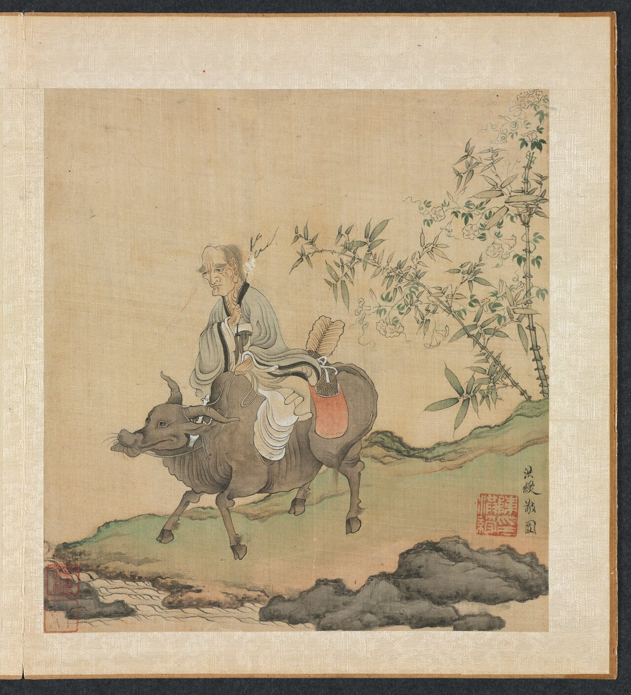
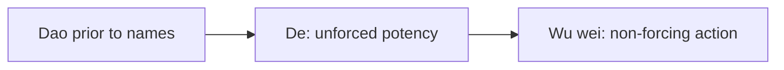

# Laozi and the *Daodejing*

**Prerequisites:** [Foundational concepts](01-foundational-concepts.md). [Confucius](02-confucius-and-the-analects.md) helps as a foil.
**Key ideas:** a short, layered text rather than a clear biography; the unsayable *Dao*; *wu wei* as non-forcing action; softness, reversal, and critique of conventional virtue; a political teaching, not only a private mysticism.

*Paintings after Ancient Masters: Laozi Riding an Ox title QS:P1476,en:"Paintings after Ancient Masters: Laozi Riding an Ox "label QS:Len,"Paintings after… Credit: Chen Hongshou. License: Public domain. Source: [File:Chen Hongshou - Paintings after Ancient Masters, Laozi Riding an Ox - 1979.27.1.2 - Cleveland Museum of Art.tiff](https://commons.wikimedia.org/wiki/File:Chen_Hongshou_-_Paintings_after_Ancient_Masters,_Laozi_Riding_an_Ox_-_1979.27.1.2_-_Cleveland_Museum_of_Art.tiff).*
"Laozi" names both a legendary figure (the "Old Master," sometimes identified with a Zhou archivist named Li Er or Lao Dan) and the short book also called the *Daodejing* or *Laozi*. Traditional stories have Confucius consulting him and the old man departing west, leaving the book with a gatekeeper. Modern scholarship generally treats the text as composite, taking shape over the Warring States period, with a received version later standardized. Read the book; hold the biography lightly.

The text is about five thousand characters, poetic, repetitive, and deliberately elusive. That style is part of the argument. If the real Way could be captured in a confident definition, the opening line would be false: "The *Dao* that can be told is not the constant *Dao*. The name that can be named is not the constant name."

## The *Dao* and *De*

Where Confucians speak of the way of the former kings, the *Daodejing* points to a source prior to names, distinctions, and artifacts. The *Dao* is like water, like an uncarved block, like a valley, like the emptiness in a hub or a room — useful because it is not filled up. The ten thousand things arise from it, and it does not claim them as possessions.

*De* in this book is the potency of what stays close to that Way. It is not the Confucian *junzi*'s accumulated ritual self, or not primarily. It is a kind of unforced effectiveness, often described through images of softness: water wears down stone; the infant and the female are models of vitality; the wise do not contend, and so nothing can contend with them.

## *Wu wei*

*Wu wei* is commonly translated "non-action," which sounds like passivity. "Non-forcing" or "non-contrivance" is closer. The teaching is to act in a way that does not fight the grain of things: a ruler who interferes less, a person who does not over-manage the world with techniques and slogans.

This is also a political theory. The *Daodejing* is full of advice to sages and rulers. A state is best when the people are settled, lightly governed, and not inflamed by luxury, weapons, and moral advertising. "The more prohibitions, the poorer the people." "When the great *Dao* is abandoned, there is *ren* and rightness" — a direct jab at the Confucian (and Mohist) project of promoting virtue by name. From this angle, public campaigns for morality are often symptoms of a lost simplicity, not cures.

Whether this is a romantic anarchism, a quietist counsel, or a quite hard-headed recipe for ruling by not provoking resistance is a genuine interpretive fork. The text supports more than one reading, and later "Daoism" develops in several directions (philosophical, religious, alchemical). For a first pass, keep the political edge visible. This is not only poetry about streams.

## Reversal and the critique of sharpness

A recurring pattern is reversal: what looks weak wins; what is full tips over; to arrive, leave space. The book is suspicious of sharp tools, cleverness, and the kind of knowledge that cuts the world into useful pieces and then cannot stop cutting. This makes it a foil to both Confucian cultivation and Legalist control — and, later, a resource for critics of frantic striving in any system.

It is also easy to misuse. "Don't force" can become an excuse not to resist cruelty. The text itself talks about weapons as ill-omened tools and about not delighting in victory. Read it as a discipline of desire and of government, then test it against [Zhuangzi](05-zhuangzi.md), who shares some of the vocabulary and is funnier, stranger, and less interested in advising a throne.

## Where this leads

- Next: [Zhuangzi](05-zhuangzi.md)
- Contrast with active moral programs: [Confucius](02-confucius-and-the-analects.md), [Mohism](06-mohism.md)
- A Greek interest in living according to nature, with a very different physics: [Stoics and Epicureans](../greek/06-hellenistic-schools.md)
