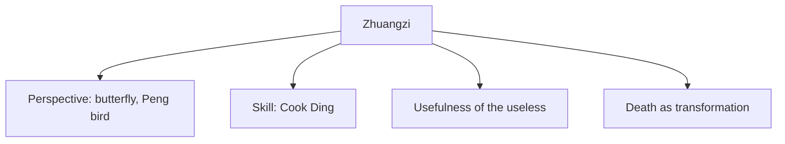

# Zhuangzi

**Prerequisites:** [Laozi and the *Daodejing*](04-laozi-and-the-daodejing.md)
**Key ideas:** a book of stories and thought-experiments; perspective and the limits of fixed names; skillful spontaneity; the usefulness of the useless; death and transformation without panic.

The *Zhuangzi* is associated with Zhuang Zhou (fourth century BCE). Like other early Chinese books, it is layered: the "Inner Chapters" are often treated as closest to a historical Zhuangzi, while the Outer and Miscellaneous chapters include later hands in a related spirit. The voice is unlike the *Analects* or the *Daodejing*: parables, jokes, talking skulls, enormous fish, and arguments that fold into themselves.

If the *Daodejing* often sounds like counsel to a sage-ruler, the *Zhuangzi* is more interested in how a person might move through a world of forced distinctions without being broken by them.

## Perspective

The book repeatedly loosens the authority of our ordinary standpoint. The vast Peng bird and the little cicada do not share a sense of what counts as far. A human "right" and "wrong" may be a monkey's irrelevance. In the famous butterfly dream, Zhuangzi does not know whether he is a man who dreamed of being a butterfly or a butterfly dreaming he is Zhuangzi — and he is not sure the question has a final, one-sided answer.

This is sometimes called relativism. That can be too quick. Zhuangzi is not always saying "every view is equally true." He is showing how vocabularies of use, honor, and debate trap us, and how "this" and "that" generate each other. The later Mohists and the Confucians want reliable standards for names. Zhuangzi is the great early critic of that confidence. The point is often therapeutic: once you see that your framework is a framework, you can stop spending your life defending it as the only possible world.

## Skill and *wu wei*

Some of the best-known stories are about artisans: Cook Ding carving an ox, a woodworker preparing a bell-stand, a swimmer at home in the rapids. They do not succeed by imposing a theory on the material. After years of practice, they move through the spaces where the knife (or the body) does not meet resistance. The ox falls apart as if of itself.

This is *wu wei* as skillful spontaneity, not as withdrawal. It is also a picture of knowledge that is embodied and situational, closer to Aristotelian *phronesis* or craft knowledge than to a definition you could write on a board. The *Zhuangzi* is not against all learning. It is against a kind of cleverness that never leaves the realm of fixed words.

## The useless and death

A gnarled tree survives because it is no good for beams. A person might live longer by not being useful to a state's projects. "The usefulness of the useless" is a joke with a political edge, in a century when states were hungry for talent and for bodies.

On death, Zhuangzi is startlingly calm. When his wife dies, he is found drumming on a tub: she has gone back into the transformations of things, as the seasons do. Grief has its moment, but treating death as a unique catastrophe may be a failure of perspective. This is not exactly Epicurean ("death is nothing to us" because the atoms disperse) and not exactly Stoic (assent to fate as the *logos* of a rational cosmos). It is closer to a trust in transformation: we were not always "us," and we will not always be, and the process is not an insult.

The *Zhuangzi* is one of the great books about freedom, if freedom means not being owned by conventional success, fear of death, or the need to win the argument. It can also be read as dangerously quietist. As with the *Daodejing*, the right first step is to let the stories work, then to ask what kind of life they make possible — and what kind of injustice they might decline to name.

## Where this leads

- Next: [Mohism](06-mohism.md), which wants the clear standards Zhuangzi distrusts
- Related Greek experiments in shrinking fear and loosening convention: [Hellenistic schools](../greek/06-hellenistic-schools.md)
- Back to the political hard edge the Daoist texts often sidestep: [Legalism](07-legalism.md)
