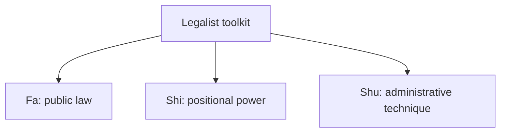

# Legalism

**Prerequisites:** [Foundational concepts](01-foundational-concepts.md). [Xunzi](03-mencius-and-xunzi.md) and [Mohism](06-mohism.md) are useful background.
**Key ideas:** *fa*, *shi*, and *shu* as instruments of statecraft; a bet on institutions over moral example; Qin as historical fulfillment and warning; "Legalism" is not liberal rule of law.

"Legalism" (*fajia*) is a later label for a cluster of Warring States statecraft thinkers, above all Shang Yang, Shen Buhai, Shen Dao, and Han Feizi (d. 233 BCE). They are not a school in the sense of a single founder and a canon of virtue. They are a set of answers to the same problem everyone else is facing — how to make a state survive and prevail — that refuse to put their trust in the ruler's *ren*.

The Qin state adopted much of this program, unified China in 221 BCE, and collapsed within a generation. That history has colored the tradition ever since: impressive administrative clarity, and a reputation for harshness.

## Three tools: *fa*, *shi*, *shu*

Han Feizi, the great synthesizer, is often taught through three terms.

***Fa*** means law, standard, or publicly promulgated rule. Rewards and punishments should be clear, relatively impersonal, and actually applied. The point is predictability and control, not moral education in the Confucian sense. If the standard is public, even a mediocre ruler can govern, because the machine does not depend on his personal sageliness.

***Shi*** is positional power — the authority that belongs to the throne as a throne. Shen Dao especially stresses this: influence should come from the seat, not from the charisma or virtue of the occupant. If order depends on a sage appearing, you will wait a long time.

***Shu*** is technique: the administrative methods a ruler uses to appoint, monitor, and assess officials, often quietly, so that ministers cannot capture the state. Shen Buhai is associated with this bureaucratic art. The ruler may appear inactive, but it is not Daoist *wu wei* as attunement to the cosmic Way. It is the inactivity of someone who uses machinery so that he does not have to wrestle each official one by one.

Human beings, on this picture, reliably follow interest. You design the system for the people you have, not for the people Mencius hopes to grow. Han Feizi is rhetorically brilliant on the fragility of moral example: affection and virtue do not consistently control a household, let alone a state.

## What this is not

It is important not to confuse *fajia* with modern **rule of law**. In a liberal legal order, law is supposed to bind the rulers as well as the ruled, and it is often justified by rights or consent. Legalist law is an instrument of the state's strength. The ruler stands at the apex of the apparatus. There is little room here for a Mencian right to remove a tyrant, or for a Mohist appeal to Heaven against an unjust campaign, except insofar as failure itself is the verdict.

The tradition is also not simply "cruelty." Shang Yang's reforms (land policy, conscription, weakening of hereditary nobility, harsh but published penalties) were about building a war-capable, centralized state. You can understand the administrative achievement and still judge the human cost. The short life of Qin is often read as evidence that fear without a thicker moral culture cannot hold a world together; it can also be read as a failure of particular policies and successors. The encyclopedia's job is to keep both the conceptual tools and the historical warning in view.

Read alongside [Xunzi](03-mencius-and-xunzi.md), Legalism looks like what happens if you take "nature will not save us" and discard ritual as the main corrective. Read alongside the *Daodejing*, Han Feizi sometimes borrows the language of emptiness and stillness for the ruler, then fills it with surveillance. The shared words (*Dao*, *De*, *wu wei*) do not mean the shared project.

## Where this leads

- Next: [Yin-Yang and the Five Phases](08-yin-yang-and-five-phases.md), a cosmology later used to legitimize and organize imperial order
- Then stand back: [Greek and Chinese compared](../greek-and-chinese-compared.md)
- For Greek political bets on education versus institutions, see [Plato](../greek/04-plato.md) and [Aristotle](../greek/05-aristotle.md)
