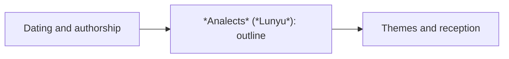

# *Analects* (*Lunyu*)

**Prerequisites:** [Confucius](../thinkers/confucius.md)

*The teaching Confucius. Portrait by Wu Daozi, 685-758, Tang Dynasty. Credit: Wu Daozi, 685-758, Tang Dynasty.. License: Public domain. Source: [File:Confucius Tang Dynasty (cropped).jpg](https://commons.wikimedia.org/wiki/File:Confucius_Tang_Dynasty_(cropped).jpg).*
## Dating and authorship

A compiled record of sayings and conversations of [Confucius](../thinkers/confucius.md) and his disciples, assembled over generations. Traditional reading treats it as the authentic voice of the master. Modern scholarship sees strata (some clusters of chapters looking earlier, some later) and editorial shaping into the early empire. The received text is twenty "books" of short entries, not a treatise with a plot.

## Outline and key ideas

There is no linear argument. The book is best read slowly, entry by entry, watching a few terms gather force: [*ren*](../../../../glossary/chinese/ren.md), [*li*](../../../../glossary/chinese/li-ritual.md), the [*junzi*](../../../../glossary/chinese/junzi.md), [*xiao*](../../../../glossary/chinese/xiao.md), the rectification of names, learning and reflection, government by moral power. Famous lines (the three things the *junzi* takes as his burden; "do not impose on others..."; "at fifteen I set my heart on learning...") are more than slogans once the surrounding entries are in your ear. The Confucius of the *Analects* is often more tentative and more ironic than the later saint.

Recommended translations for this path include Edward Slingerland (with traditional commentary) and D. C. Lau.

## Reception

The *Analects* became the central Confucian book, and under [Zhu Xi](../../../imperial/chinese/thinkers/zhu-xi.md) one of the Four Books of the examination curriculum. Every later Confucian argument (nature, ritual, politics) claims it. It rewards the same kind of reading a book of short, repeatable conversations rewards — not a hunt for a single system on a first pass.

## How to read it

The *Analects* is a book of scenes and sayings, not a treatise with a single argument you can outline in five points. Read it in clusters, not only as isolated aphorisms. Follow one theme — *ren*, filiality, the gentleman, government, learning — across several books, and notice how a later remark qualifies an earlier one. Pay attention to who is speaking and who is being corrected: a saying to Zilu is not always a saying to Zigong. Traditional chapter and book divisions are later, but they still help you pace the work.

A common mistake is to extract a modern inspirational sentence and leave the ritual and political frame behind. Another is to treat the whole as Confucius' diary. Much of the text is a school memory, compiled and shaped after his death; some passages are widely thought later than others. That does not make the book unusable. It makes it a record of a tradition thinking with a founder. Compare, when you are ready, the warmer moral psychology of the *Mencius* and the tougher ritualism of the *Xunzi*, both of which inherit this book and argue about what it requires.

## Key ideas

- A layered compilation of sayings, not a single-authored treatise.
- *Ren*, *li*, the *junzi*, and government by *De* are the recurring first principles.
- Later orthodoxy and the text's own tentativeness should both be heard.

## Where this leads

- Thinker: [Confucius](../thinkers/confucius.md)
- Next books in the school: [*Mencius*](mencius.md), [*Xunzi*](xunzi.md)
- Concept: [ren and li](../../../../concepts/ethics/ren-and-li.md)
