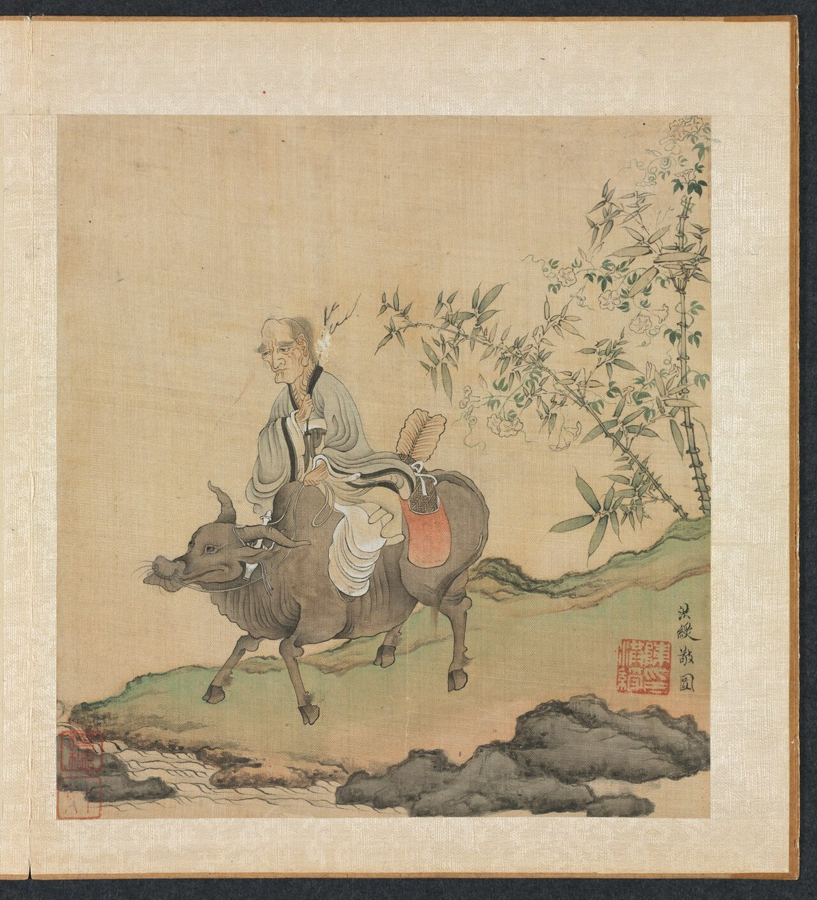
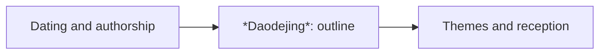

# *Daodejing*

**Prerequisites:** [Laozi](../thinkers/laozi.md)

*Paintings after Ancient Masters: Laozi Riding an Ox title QS:P1476,en:"Paintings after Ancient Masters: Laozi Riding an Ox "label QS:Len,"Paintings after… Credit: Chen Hongshou. License: Public domain. Source: [File:Chen Hongshou - Paintings after Ancient Masters, Laozi Riding an Ox - 1979.27.1.2 - Cleveland Museum of Art.tiff](https://commons.wikimedia.org/wiki/File:Chen_Hongshou_-_Paintings_after_Ancient_Masters,_Laozi_Riding_an_Ox_-_1979.27.1.2_-_Cleveland_Museum_of_Art.tiff).*
## Dating and authorship

A short, roughly five-thousand-character text in two parts (*Dao* and *De*), traditionally ascribed to [Laozi](../thinkers/laozi.md). The received "Wang Bi" text is a later standardized edition. Manuscripts from Guodian and Mawangdui show earlier, different arrangements and wording. The book is composite; "Laozi" is the name of a voice and a tradition. Many English translations exist; D. C. Lau, Hans-Georg Moeller, and Robert G. Henricks (for the earlier manuscripts) are among the reliable starting points. Compare at least two: the text is brief and endlessly re-translatable.

## Outline and key ideas

There is no plot. A set of short, often paradoxical chapters returns to the unsayable [*Dao*](../../../../concepts/metaphysics/dao-as-way-and-source.md), to [*De*](../../../../glossary/chinese/de.md) as unforced potency, to [*wu wei*](../../../../concepts/ethics/wu-wei.md), to softness, reversal, and a politics of not inflaming the people. "The *Dao* that can be told is not the constant *Dao*" is the famous opening of the received text (the manuscript order sometimes differs). Read slowly, more than once, and do not extract a single slogan as the whole.

## Reception

The most translated Chinese book after some world-religion lists, a founding text of philosophical and religious Daoism, and a perennial resource for critics of striving. Keep [Zhuangzi](zhuangzi.md) next to it so "Daoism" does not collapse into one tone.

## How to read it

The *Daodejing* is short, patterned, and resistant to being treated as a single linear argument. Read it slowly, a few chapters at a time, and let the images (water, the uncarved block, the valley, the female, the empty hub) do work before you translate them into a theory. Notice the political address: much of the book is advice, or a warning, to a ruler about forcing, displaying, and over-governing. The famous opening — the *dao* that can be spoken is not the constant *dao* — is a claim about naming and about source, not a license to make the text mean anything.

Textual history matters here more than in some other classics. The received Wang Bi order is not the only early order; Mawangdui and Guodian finds show a living, slightly fluid text in the late Warring States and early Han. Traditional ascription to a sixth-century Laozi is a traditional story, not the usual scholarly dating of the compilation. Read at least one careful translation with notes (such as D. C. Lau, or later annotated versions) and, when you can, look at how two translations handle a single dense chapter. Then read some *Zhuangzi* inner chapters, which share a family atmosphere and a very different literary method. Do not begin with later religious Daoist commentary if your aim is the classical philosophical work.

## Key ideas

- A short, layered, manuscript-rich classic, not a single-author treatise with a secure biography.
- *Dao*, *De*, *wu wei*, softness, and a critique of named virtue.
- Translation choice changes the book; compare versions.

## Where this leads

- Thinker: [Laozi](../thinkers/laozi.md)
- Next: [*Zhuangzi*](zhuangzi.md)
- Concept: [wu wei](../../../../concepts/ethics/wu-wei.md)
