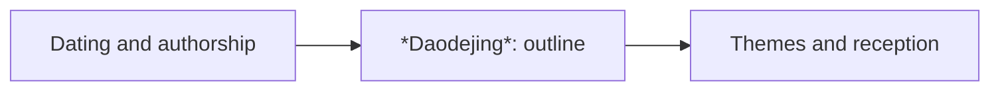

# *Daodejing*

**Prerequisites:** [Laozi](../thinkers/laozi.md)

## Dating and authorship

A short, roughly five-thousand-character text in two parts (*Dao* and *De*), traditionally ascribed to [Laozi](../thinkers/laozi.md). The received "Wang Bi" text is a later standardized edition. Manuscripts from Guodian and Mawangdui show earlier, different arrangements and wording. The book is composite; "Laozi" is the name of a voice and a tradition. Many English translations exist; D. C. Lau, Hans-Georg Moeller, and Robert G. Henricks (for the earlier manuscripts) are among the reliable starting points. Compare at least two: the text is brief and endlessly re-translatable.

## Outline and key ideas

There is no plot. A set of short, often paradoxical chapters returns to the unsayable [*Dao*](../../../../concepts/metaphysics/dao-as-way-and-source.md), to [*De*](../../../../glossary/chinese/de.md) as unforced potency, to [*wu wei*](../../../../concepts/ethics/wu-wei.md), to softness, reversal, and a politics of not inflaming the people. "The *Dao* that can be told is not the constant *Dao*" is the famous opening of the received text (the manuscript order sometimes differs). Read slowly, more than once, and do not extract a single slogan as the whole.

## Reception

The most translated Chinese book after some world-religion lists, a founding text of philosophical and religious Daoism, and a perennial resource for critics of striving. Keep [Zhuangzi](zhuangzi.md) next to it so "Daoism" does not collapse into one tone.

## Key ideas

- A short, layered, manuscript-rich classic, not a single-author treatise with a secure biography.
- *Dao*, *De*, *wu wei*, softness, and a critique of named virtue.
- Translation choice changes the book; compare versions.

## Where this leads

- Thinker: [Laozi](../thinkers/laozi.md)
- Next: [*Zhuangzi*](zhuangzi.md)
- Concept: [wu wei](../../../../concepts/ethics/wu-wei.md)
