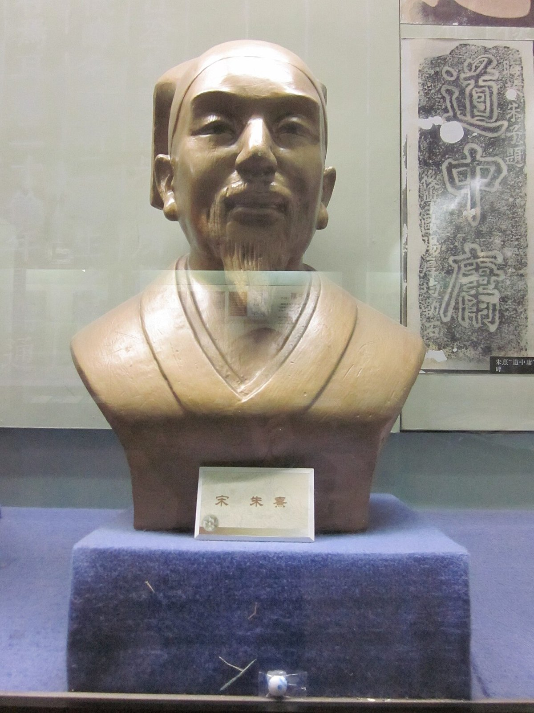
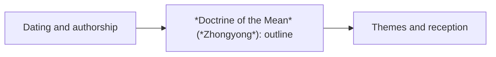

# *Doctrine of the Mean* (*Zhongyong*)

**Prerequisites:** [*Great Learning*](great-learning.md) or [*Analects*](analects.md)

*The Bust of Zhu Xi at Yuelu Academy (likely crafted from terracotta or resin with a copper finish) was created to commemorate Zhu Xi (1130–1200), the… Credit: Uploaded by Huangdan2060. License: [CC BY 3.0](https://creativecommons.org/licenses/by/3.0). Source: [File:Yuelu Academy 151.jpg](https://commons.wikimedia.org/wiki/File:Yuelu_Academy_151.jpg).*
## Dating and authorship

Another *Book of Rites* chapter, later extracted by [Zhu Xi](../../../imperial/chinese/thinkers/zhu-xi.md) as one of the Four Books. Traditional ascription to Zisi (Confucius's grandson) is traditional, not a settled historical fact. The text as we use it is again an ancient short work seen through a Song commentator. It is denser and more metaphysical than the *Great Learning*.

## Outline and key ideas

*Zhong* is the central, the not-yet-expressed mean of the nature; *yong* is the ordinary, the constant practice. Heaven's mandate is called nature; following nature is called the Way; cultivating the Way is called teaching. The text moves from this opening into the work of the gentleman, sincerity (*cheng*) as the Way of Heaven and of the human being who hits the mark, and a cosmic reach in which the sincere person is said to form a triad with Heaven and Earth. It is one of the most "metaphysical" of the short Confucian classics, and a main bridge toward Song *li* philosophy, even though it is not yet Zhu Xi's system.

## Reception

A Four Books pillar, a resource for later Confucian spirituality, and sometimes a text read too quickly as if it were already Neo-Confucianism. Keep it next to the *Analects* so the earlier, drier moral psychology is not forgotten, and next to Zhu Xi so you can see what was made of it.

## How to read it

The *Doctrine of the Mean* (*Zhongyong*) should be read twice: once for its ethical claim about hitting a timely, balanced course and about sincerity (*cheng*), and once for its more cosmic register, in which the sincere person forms a triad with Heaven and Earth. The "mean" here is not Aristotle's *mesotes* under another name. It is closer to an unwavering centrality that still knows how to be timely, and to a metaphysical confidence about the way of Heaven that the *Analects* usually leaves unspoken.

Like the *Great Learning*, this is a *Liji* chapter that later became a Four Book, with a decisive Song commentary tradition. Traditional links to Zisi (Confucius' grandson) are the received story; dating is discussed and later than the historical Confucius. Read a modest translation with the Chinese terms kept in view (*zhong*, *yong*, *cheng*), and resist the urge to shrink the text into "moderation." After Zhu Xi and Wang Yangming have appeared on your path, come back: much of their argument about the heart and principle is an argument about how far this short text can be taken.

## Key ideas

- A *Liji* chapter later canonized as a Four Book.
- Nature, Way, teaching, and sincerity (*cheng*) as a chain from Heaven to practice.
- A more cosmic Confucianism than the *Analects* usually offers, later crucial for the Song.

## Where this leads

- [*Great Learning*](great-learning.md), [*Mencius*](mencius.md)
- [Zhu Xi](../../../imperial/chinese/thinkers/zhu-xi.md)
- Glossary: [*zhong-yong*](../../../../glossary/chinese/zhong-yong.md)
