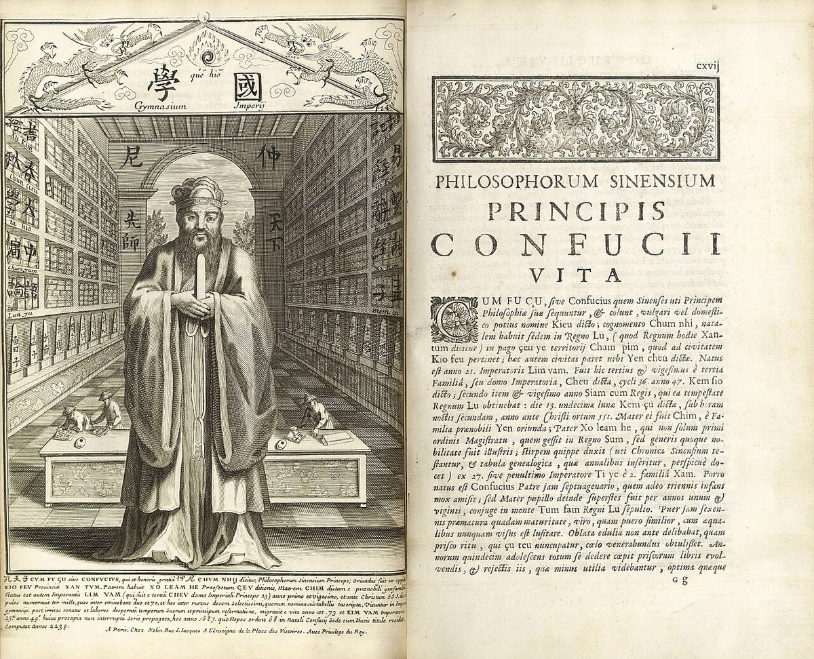
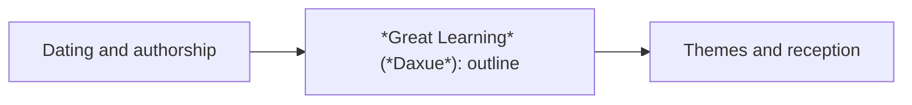

# *Great Learning* (*Daxue*)

**Prerequisites:** [*Analects*](analects.md); later context: [Zhu Xi](../../../imperial/chinese/thinkers/zhu-xi.md)

*Pages from Confucius Sinarum Philosophus ("Confucius, the Philosopher of the Chinese"), an annotated Latin translation of three of the "Four Books" of Qing… Credit: Prospero Intorcetta, Philippe Couplet, et al.. License: Public domain. Source: [File:LifeAndWorksOfConfucius1687.jpg](https://commons.wikimedia.org/wiki/File:LifeAndWorksOfConfucius1687.jpg).*
## Dating and authorship

A short text that began as a chapter of the *Book of Rites* (*Liji*), of uncertain date (late Warring States to early Han, in most estimates). Traditional ascriptions to Confucius or to Zengzi are not literal authorship claims a historian can sign. [Zhu Xi](../../../imperial/chinese/thinkers/zhu-xi.md) extracted it, rearranged and commented on it, and made it the first of the Four Books — so the *Great Learning* most people mean is a Song-framed ancient chapter. Daniel Gardner's translation of the Four Books is a good way to see that framing.

## Outline and key ideas

The famous "chain" runs from the investigation of things (*[gewu](../../../../concepts/epistemology/investigation-of-things.md)*) and the extension of knowledge, through sincerity of intention, rectification of the mind, cultivation of the person, regulation of the family, and ordering of the state, to peace under Heaven. Inner work and political work are one sequence, not two subjects. The text is brief, even more so than the *Analects*, and almost every phrase became a battleground: Zhu Xi and [Wang Yangming](../../../imperial/chinese/thinkers/wang-yangming.md) disagree sharply on what "investigating things" means and where moral knowing starts.

## Reception

Without Zhu Xi this would be a minor ritual chapter. With him it became the opening textbook of an empire's elite. Read the ancient short text, then read it again as a Song curriculum document.

## How to read it

The *Great Learning* is short and almost too quotable. Read it first as a single chain: investigate things, extend knowledge, make the thoughts sincere, rectify the heart, cultivate the person, regulate the family, govern the state, bring peace to the world. The order is the philosophy. Personal cultivation is not a private hobby that politics may ignore; it is the root of public order. Then read it a second time with the traditional commentary in view, especially the later Song emphasis (Zhu Xi) that made this text one of the Four Books and turned "investigation of things" into a lifelong program.

The work is a chapter of the *Liji* (Record of Rites) that became a classic in its own right. Traditional ascriptions (Confucius, Zengzi, later editors) are part of its reception; modern scholars treat it as a late Warring States or early Han Confucian text in ritual clothing. Do not let its brevity make you rush. Almost every later fight about *gewu*, about the relation of inner and outer, and about whether the chain can be started from the heart or must start from things, is already a fight about how to read these few pages. The *Doctrine of the Mean* is its natural companion.

## Key ideas

- An ancient *Liji* chapter, later made the gateway Four Book.
- From inner cultivation to family, state, and *tianxia* in one chain.
- *Gewu* is the phrase later Confucians fight over most.

## Where this leads

- [*Doctrine of the Mean*](doctrine-of-the-mean.md)
- [Zhu Xi](../../../imperial/chinese/thinkers/zhu-xi.md), [Wang Yangming](../../../imperial/chinese/thinkers/wang-yangming.md)
- Concept: [investigation of things](../../../../concepts/epistemology/investigation-of-things.md)
