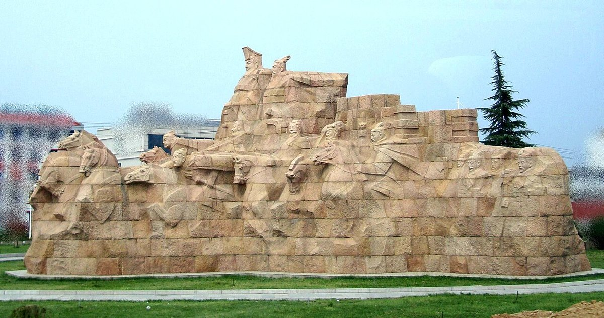

# *Han Feizi*

**Prerequisites:** [Han Feizi](../thinkers/han-feizi.md); helpful: [*Xunzi*](xunzi.md) and the [*Book of Lord Shang*](book-of-lord-shang.md)

*A modern statue of the First Emperor and his attendants, on display at Xian. Credit: GwydionM at English Wikipedia. License: Public domain. Source: [File:First Emperor.jpg](https://commons.wikimedia.org/wiki/File:First_Emperor.jpg).*
## Dating and authorship

A large collection of essays under the name of [Han Feizi](../thinkers/han-feizi.md) (d. 233 BCE). A core is widely taken as his; some chapters may be later or school material. It is the most complete surviving Legalist book, and one of the best-written political works of the Warring States. Burton Watson's selection is a good start; complete translations exist for a fuller pass.

## Outline and key ideas

The book teaches a ruler to use **[*fa*](../../../../glossary/chinese/fa.md)** (public law and standards), **[*shi*](../../../../glossary/chinese/shi-positional-power.md)** (the power of the position), and **[*shu*](../../../../glossary/chinese/shu-technique.md)** (techniques for managing ministers). Anecdotes of ruined states and clever ministers make the argument concrete: do not rely on the moral worth of persons; design the machine so that even a mediocre occupant of the throne can control a staff that is, by default, self-interested. "The two handles" of reward and punishment must not be lent out. The book can sound like the [*Daodejing*](daodejing.md) when it praises the ruler's emptiness and stillness, and then the stillness is filled with surveillance and legally fixed incentives. Several chapters also review earlier figures (Shang Yang, Shen Buhai, Shen Dao) and absorb them.

## Reception

The Qin dynasty made this style of thought infamous and historically unavoidable. Confucian readers treated the book as a manual of tyranny. It remains essential: not as a guide to emulate, but as the clearest ancient Chinese theory of government by impersonal standard and positional power, and as a foil to [government by virtue](../../../../concepts/political/government-by-virtue.md).

## How to read it

The *Han Feizi* is a collected set of essays and illustrations, some more systematic than others, and it is best read first for the three tools — *fa*, *shi*, and *shu* — and for the diagnosis of why moralistic talk fails in a dangerous court. "The Five Vermin," "The Two Handles," and the essays on preventing ministers from capturing the state are a good spine. The historical anecdotes are not decoration; they are the evidence the argument thinks it has. Han Fei is a bitter, lucid writer, and a complete translation (Burton Watson's selection, or a fuller modern version) should be read slowly enough that the ruthlessness does not become a blur.

Authorship is, as usual, a mix of a named master and a school corpus; some chapters may be earlier Legalist or later compilation. The book is also in conversation with the *Laozi* (a quieter ruler, a use of emptiness) and with Xunzi (a dark view of unaided nature, a trust in artifice), even when it does not footnote them. Read a stretch of Confucian political hope just before or after, so that you can hear the objection as an objection. Do not tidy the book into "realism" in a modern IR sense; its world is a Warring States court, with spies, positional power, and a ruler who must not show his likes.

## Key ideas

- A synthesis of law, positional power, and administrative technique.
- Human beings are expected to follow interest; institutions, not sagehood, carry the state.
- Daoist vocabulary can appear, with a very different project inside it.

## Where this leads

- Thinker: [Han Feizi](../thinkers/han-feizi.md)
- Predecessor: [*Book of Lord Shang*](book-of-lord-shang.md)
- Concept: [fa, shi, and shu](../../../../concepts/political/fa-shi-shu.md)
