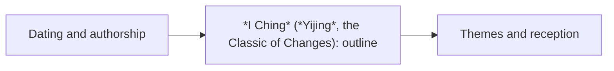

# *I Ching* (*Yijing*, the Classic of Changes)

**Prerequisites:** [Yin-Yang and the Five Phases](../08-yin-yang-and-five-phases.md); helpful: [foundational concepts](../01-foundational-concepts.md)

*The teaching Confucius. Portrait by Wu Daozi, 685-758, Tang Dynasty. Credit: Wu Daozi, 685-758, Tang Dynasty.. License: Public domain. Source: [File:Confucius Tang Dynasty (cropped).jpg](https://commons.wikimedia.org/wiki/File:Confucius_Tang_Dynasty_(cropped).jpg).*
## Dating and authorship

The *Changes* is a layered classic, older in its core than most of the philosophical books in this folder, and later than its own legend. A set of sixty-four hexagrams (six-line figures of broken and unbroken lines), with short judgments, grew over the early Zhou and after; a body of commentaries called the **Ten Wings**, including the *Great Commentary* (*Xici*), was added later and traditionally attributed in part to Confucius — a traditional claim modern scholarship does not generally accept as literal authorship. The received book is both a divination manual and a cosmological-philosophical text, depending on which layers you are in. Richard John Lynn's translation (with Wang Bi's commentary) and, for a different tradition, the Wilhelm/Baynes version (read with caution as a twentieth-century spiritual classic as well as a translation) are common English starting points.

## Outline and key ideas

Each hexagram has a name, a judgment, and line statements used in divination. The philosophical layers read the play of broken and unbroken lines as the play of [yin and yang](../../../../concepts/metaphysics/yin-yang-and-correlative-cosmology.md), and the sequence of hexagrams as a picture of change in a patterned world: "generating generation is called change." The *Great Commentary* offers some of the most influential early statements about the *Dao*, the complementary pairing of Heaven and Earth, and the sage who models himself on cosmic process. This is not yet [Zhu Xi](../../../imperial/chinese/thinkers/zhu-xi.md), and it is not the same project as the *Analects*, but later Confucians, as well as Daoist and popular readers, all claimed the book.

## Reception

One of the Five Classics of the Confucian canon, a divination text still used, and a book so often occulted in the West that its first-principles place can be missed: it is an early Chinese attempt to think **change as patterned and readable**, not as chaos, and to tie decision (the oracle) to that pattern. Read it here as a cosmological classic with a long commentary tradition, not first as a fortune-telling app.

## How to read it

The *Yijing* (*I Ching*, *Changes*) is a layered book: an older core of hexagrams, line statements, and divinatory language, and later wings of commentary (the Ten Wings) that turn those signs toward cosmology, ethics, and a philosophy of change. A first reading should not begin with a fortune-telling mindset, nor with a demand that every line already be a metaphysical treatise. Learn how a hexagram is built (six lines, broken and unbroken), read a few well-known hexagrams slowly, and then read the "Great Treatise" (Xici) for the later philosophical voice about complementary opposites, timeliness, and the sage's use of the changes.

Authorship legends (Fu Xi, King Wen, the Duke of Zhou, Confucius) belong to the tradition's self-portrait. Historical-critical work distinguishes strata over a long period, from early divinatory materials into Warring States and Han interpretive layers. Use a translation that keeps text and later commentary distinct (and that does not quietly modernize everything into "self-help"). The book is a source for correlative thinking and for a view of change as patterned rather than as a Greek crisis of being. It is not a short cut to "Chinese philosophy" as a whole, and it should sit beside, not above, the *Analects*, *Mozi*, and *Zhuangzi*.

## Key ideas

- A layered work: hexagram divination plus later philosophical "Wings."
- Yin-yang process and readable change, not a single-author treatise.
- Confucian, Daoist, and popular afterlives all exist; traditional "Confucius wrote the Wings" is not the scholarly view.

## Where this leads

- Survey: [Yin-Yang and the Five Phases](../08-yin-yang-and-five-phases.md)
- Concept: [yin-yang and correlative cosmology](../../../../concepts/metaphysics/yin-yang-and-correlative-cosmology.md)
- Later reader: [Zhu Xi](../../../imperial/chinese/thinkers/zhu-xi.md)
